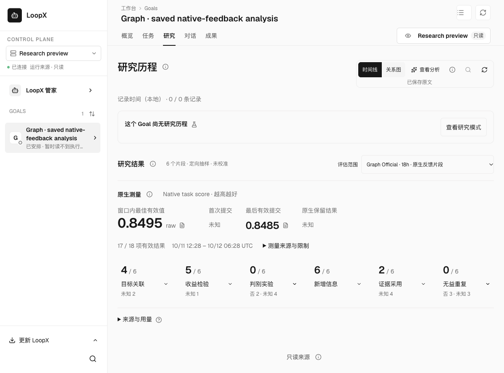
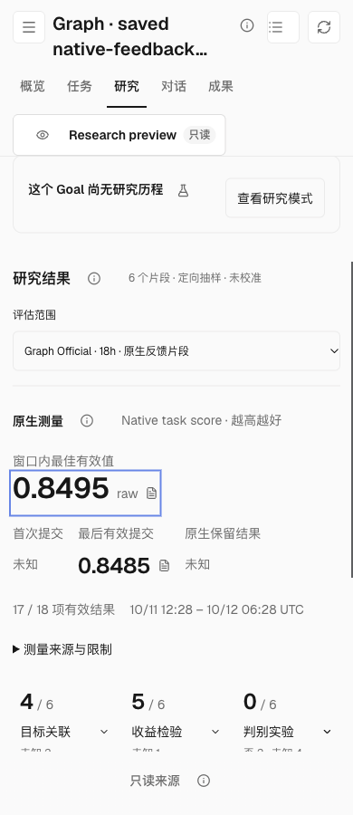
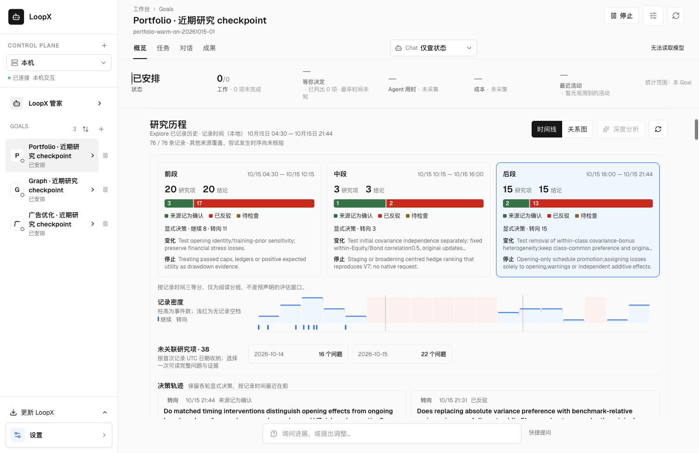
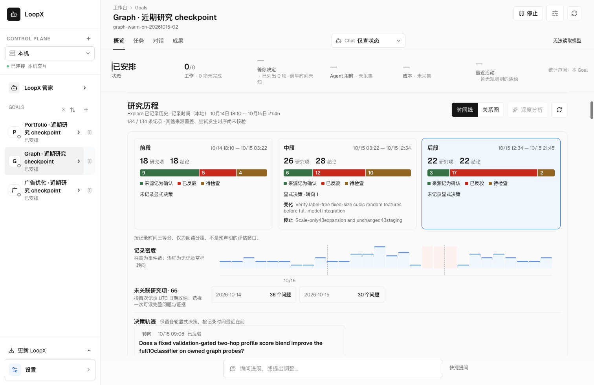
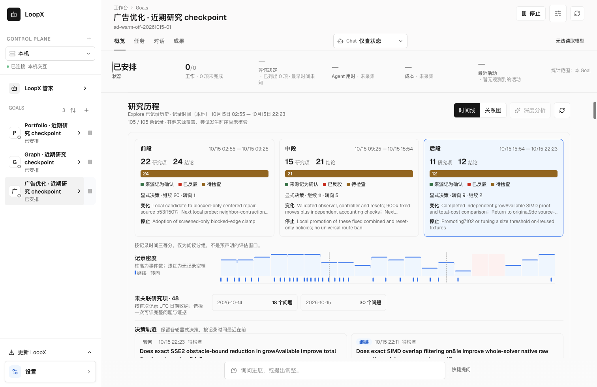
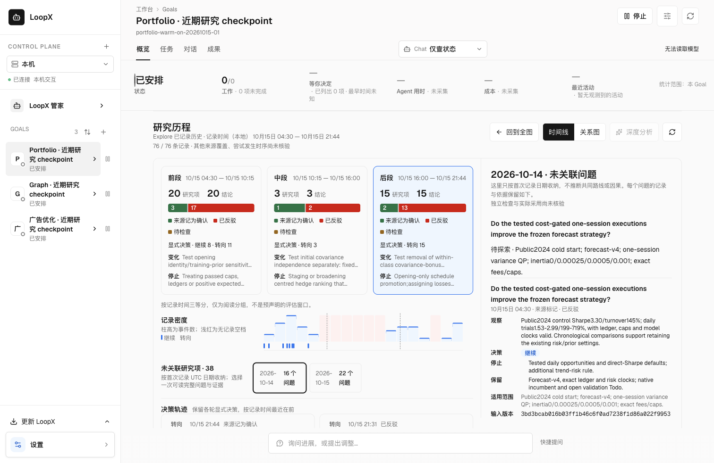
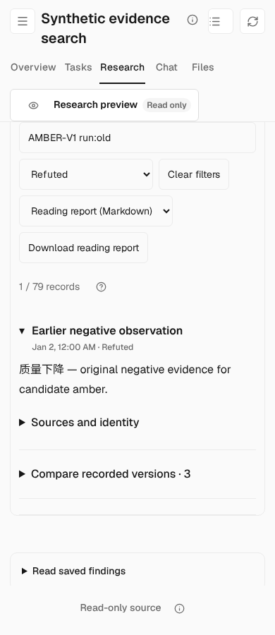

# Real benchmark reference fixtures

The default read-only preview uses the complete saved Explore log from the
3 November Grid Turing Robot context-on run. The `research-real-benchmark`
browser scenario reads both context arms, the Ad and Schema histories below,
the saved Graph analysis, and Portfolio/Ad native results without saved analysis
through the real HTTP history owner. It verifies complete original text and append order, download
readback, source preservation, no writes, and desktop/390px reading. These are
the core populated-page references; synthetic fixtures cover boundaries such
as races, artificial paging pressure and missing fields.

| Source | Records | Node / finding records | Recorded interval (UTC) | Original JSONL SHA-256 |
| --- | ---: | ---: | --- | --- |
| [Grid context on](../../apps/presentation/dashboard/src/data/fixtures/edgebench-grid-context-on-20261103-history.json) | 33 | 8 / 25 | 2026-11-03 06:02:35–15:06:44 | `292f493ee5d88e0f99546776ee2a46958e19517ceae192c10288276f270f404d` |
| [Grid context off](../../apps/presentation/dashboard/src/data/fixtures/edgebench-grid-context-off-20261103-history.json) | 11 | 2 / 9 | 2026-11-03 06:04:18–14:55:52 | `d91047d06aa7ef43249bc79e70d8ba53d37a88240c124dcd17a75034ea524375` |

All saved Explore events are included, without sampling, rewriting or redaction.
No credentials or private absolute paths were found in the selected display
state. Native authority/credential stores, session transcripts, evaluator
internals and task workspaces are excluded. Each fixture carries its original
run identity and limitations. Both runs retain `runner_invalid`, diagnostic
scope and `score_countable=false`; displaying their observations does not
qualify a causal comparison. Recording intervals are not active solver time.

The records expose real reading pressure: long repeated questions, multiple
measurement scopes, null execution observations, rejected local variants and an
unresolved timeout. All findings happen to carry the source's `confirmed`
label; one reports **no measured gain** and another preserves an unknown native
outcome. The frontend must preserve that distinction rather than infer benefit
from a status label. Neither log records explicit relationship edges or parents.
Missing structured decisions now take an on-demand disclosure rather than an
empty first-screen section. Opening a record reuses the existing observation,
interpretation and measurement reader, with complete original wording on demand;
the same layout applies without a generated display analysis. Exported records
remain original data.

Run `uv run --extra test python examples/personal-workspace-browser/research-history-backend.py`
after building the Chat bundle to open the default source. Pass `--fixture` with
the context-off file to inspect it separately. Both sources genuinely use
`benchmark-goal` in separate runtimes: do not rename or merge them into invented
Goals. This reader materializes display events in disposable scaffolding; it
does not restore execution state or observe an installed/live worker.

Run `LOOPX_PERSONAL_WORKSPACE_PACKAGED=1 LOOPX_PERSONAL_WORKSPACE_SCENARIO=research-real-benchmark node examples/personal-workspace-browser-smoke.mjs`
for the core reading journey. The Python history suite independently freezes the
original JSONL digests and sizes. The two source byte totals are 80,992 and
20,575; their exact original serialization can be reconstructed as described
below. No model or solver is called by this scenario.

The attached work-conversation scenario also uses the complete Grid context-on
fixture as a tool result, replacing repeated invented validation lines. The
production attached reader and HTTP detail pages must deliver the entire JSON
object into the packaged conversation, including every original observation and
its diagnostic/unknown boundaries, at desktop and 390px widths. A single synthetic
Unicode prefix retains the character-offset regression. The disposable host peer,
tool call and carrier messages are synthetic; this does not reconstruct a real
benchmark conversation or qualify model, installed App or original-host adoption.
The peer registry pins its disposable runtime instead of consulting the operator's
implicit default roots; conflicting defaults are covered by the HTTP regression.
The separate artificial paging, transport-failure and heavy-tool stress cases
remain boundary tests.
The narrow work view keeps the native source, reply/unknown state and original-App
action in one status band. Its icon retains the full accessible action name,
keyboard activation and native failure/recovery path; the original-App action is
never a substitute for reading the complete record in LoopX.

The same core scenario now includes two record-rich histories from different
tasks, with all **349 original events** retained:

| Source | Records | Node / finding records | Recording interval (UTC) | Original JSONL SHA-256 |
| --- | ---: | ---: | --- | --- |
| [Ad placement](../../apps/presentation/dashboard/src/data/fixtures/edgebench-ad-20261023-history.json) | 255 | 65 / 190 | 22 October 17:31:31–23 October 07:35:25 | `23a55562f8ad9b808a5633c479451b78b13ad5370a35190d04fab407e3824a72` |
| [Schemathesis](../../apps/presentation/dashboard/src/data/fixtures/edgebench-schema-20261025-history.json) | 94 | 47 / 47 | 23 October 17:50:32–25 October 15:39:04 | `5473191a1f23537a48f38ba82d0dd8ba8ed5ad7daffd944f28910e7d6e19e0ab` |

Selection combines recency with the reading problem. The inspected 26 October
Ad and Schema captures contain only two and four events. These richer captures
exercise real pagination, long evidence and updates: one Ad question has **39
recorded versions**; its 65 node events describe three distinct questions. A
confirmed finding rejects a variant after a negative local comparison. The
reader must preserve that original conclusion and make every version reachable.
The Schema capture retains inherited records and originating Agent/run identities
across three UTC dates; that recording span does not measure the destination
solver's active time or invent a parent/child relationship.

Neither history records explicit edges or parent links. Ad remains
`runner_invalid`; Schema remains `cancelled`; both are score-uncountable. No
events were sampled, rewritten or redacted. The original byte sizes are 396,701
and 271,025. The core journey reads all display pages, exports every original
record, compares the first and last of the 39 Ad versions and returns keyboard
focus to the selected record at desktop/390px widths. Pass either fixture to
the same preview's `--fixture` option; their original Goal IDs stay intact.
These display captures do not include their complete session trajectories or
qualify installed App adoption, paid analysis or a scientific comparison.

## Captured session archives

The [fixed capture set](https://huggingface.co/datasets/huangrt01/loopx-edgebench-research-checkpoints-20261015/tree/a97e88f951deb6827d7051a59927860e9e4c4476/20261107-real-benchmark-trajectories) links the three real display
fixtures above to all four retained solver-session files:

| Display fixture | Captured session archive |
| --- | --- |
| Grid context on | [Grid ZIP](https://huggingface.co/datasets/huangrt01/loopx-edgebench-research-checkpoints-20261015/resolve/a97e88f951deb6827d7051a59927860e9e4c4476/20261107-real-benchmark-trajectories/grid_turing_robot.zip) |
| Ad placement | [Ad ZIP](https://huggingface.co/datasets/huangrt01/loopx-edgebench-research-checkpoints-20261015/resolve/a97e88f951deb6827d7051a59927860e9e4c4476/20261107-real-benchmark-trajectories/ad_placement_optimization.zip) |
| Schemathesis | [Schema ZIP](https://huggingface.co/datasets/huangrt01/loopx-edgebench-research-checkpoints-20261015/resolve/a97e88f951deb6827d7051a59927860e9e4c4476/20261107-real-benchmark-trajectories/schemathesis_config_modernization.zip) |

Each fixture's `provenance.trajectory_archive` pins the archive and its SHA-256.
The [manifest](https://huggingface.co/datasets/huangrt01/loopx-edgebench-research-checkpoints-20261015/blob/a97e88f951deb6827d7051a59927860e9e4c4476/20261107-real-benchmark-trajectories/manifest.json) binds native session IDs,
original/published/compressed hashes, record counts and capture variants; the
[redaction audit](https://huggingface.co/datasets/huangrt01/loopx-edgebench-research-checkpoints-20261015/blob/a97e88f951deb6827d7051a59927860e9e4c4476/20261107-real-benchmark-trajectories/redactions.json) identifies every
removed opaque encrypted field. All plaintext values and unchanged JSONL lines
were compared with the source, and all seven published files were read back by
SHA-256. The 382 Explore records remain byte-identical.

The Schema receiver's alternate runtime capture is a strict prefix missing
56 tail records; the longer worker-session file is retained. Earlier Schema
session history keeps its original identity. Complete captured files do not
establish whole-run coverage or active duration. Invalid/cancelled statuses,
unknown adoption/cost and unqualified scientific comparisons remain explicit.
The earlier checkpoint release below remains available at its original version.

中文：三例现有真实展示样例现在关联到同一固定 HF 版本的完整已捕获会话，保留
原文、身份、取消/无效状态及未知覆盖。Schema 较短副本缺少的 56 条尾部记录已
由较长原文件保留；清单和逐字段脱敏审计可查，不据此推断科学收益或完整运行覆盖。

## Earlier research checkpoints

### Saved analysis reference

The core scenario also opens the [actual Graph saved analysis](../../apps/presentation/dashboard/src/data/fixtures/edgebench-graph-saved-analysis.json)
from the 11–12 October native run in Chinese and English. Its six purposively
selected episodes preserve all 36 model judgments, complete explanations,
negative/unknown verdicts and original pack/run/revision identities. This older
case supplements the recent Grid logs; it is not another recent complete history.
The analysis headline preserves the mixed result: five recorded utility tests
and one unknown, without turning a test into a positive benefit.

The same real saved-analysis reader checks keyboard focus with the opening
click's animation callbacks held. Enter still opens the focused judgment and
Escape returns to its metric, in both languages at desktop and 390px widths.
Region focus is established when React commits the detail; a delayed frame
cannot take focus away from a reader already navigating its rows.

| Judgment | Yes / no / unknown |
| --- | --- |
| Goal alignment | 4 / 0 / 2 |
| Utility tested | 5 / 0 / 1 |
| Discrimination | 0 / 2 / 4 |
| Information gain | 6 / 0 / 0 |
| Evidence adoption | 2 / 0 / 4 |
| Avoidable repetition | 0 / 3 / 3 |

The recorded analysis used **447.0 seconds, 53,768 input and 19,278 output
tokens**. These are analysis costs; solver token usage and money remain unknown.
The invalid first submission remains missing rather than zero, and the native
best/retained result remains distinct from the final submitted candidate.

The core reader also uses the actual registered [Portfolio](../../apps/presentation/dashboard/src/data/fixtures/edgebench-portfolio-native-results.json)
and [Ad placement](../../apps/presentation/dashboard/src/data/fixtures/edgebench-ad-native-results.json)
analysis Goals. Their six-episode packs have **no saved model result or job**.
Native measurements remain readable without inventing judgments, analysis usage,
or an adoption decision:

| Captured native run | First valid comparison | Best valid | Final valid | Retained |
| --- | --- | --- | --- | --- |
| Graph | agent-2: 0.8172464473565724 | agent-16: 0.849544264387785 | agent-18: 0.8485288027628158 | agent-16: 0.849544264387785 |
| Portfolio | agent-1: **0** | agent-7: 10.86 | agent-12: 10.86 | Unknown |
| Ad placement | agent-1: 49,550,815,819 | agent-13: 49,653,326,363 | agent-16: 49,650,446,168 | Unknown |

Graph's source-bound retained improvement is **+0.032297817031212595 raw**
against its fixed agent-2 baseline. Its final candidate change is only
+0.03128235540624347. The terminal-result citation identifies agent-16 as retained;
the last submitted candidate is not silently substituted. This is a native
comparison, not LoopX's independently isolated causal contribution. Scores have
different task meanings and are not added across these runs.

The Ad capture exposed a presentation failure: four significant digits displayed
both best and final as `4.965E10`. Scientific notation now adds only enough digits
to distinguish the captured values (`4.9653E10` and `4.965E10` here). Equal native
values still display equally, and full precision remains in the citation reader.

The saved Graph analysis also preserves a negative result from round 11: a
reported rollback retained round 10 at 0.84213. Round 4 reports local experimental
follow-through, while rounds 8, 15 and 18 announce restoration or future work
without establishing completed adoption in their selected excerpts. The later
terminal retention evidence does not rewrite those earlier model judgments.
There are no positive discrimination judgments: two are no and four unknown;
bundled interventions, timing noise and missing controlled contrasts still limit
explanatory claims. Native evaluation and positive measured benefit remain
different questions. These statements describe the saved, uncalibrated analysis
of six purposive episodes, not a new whole-run or causal assessment.

This fixture freezes the real HTTP readbacks, including the Chinese/English
cache misses and the saved unspecified-language original. The packaged frontend
must recover that original without inventing a translation, changing its usage
or invoking a model. The preview replays captured GET responses; it does **not**
import the original analysis store or qualify the live execution backend. The
existing synthetic process fixture separately protects that owner boundary.
Tests pin the original HTTP byte digests and read all 36 explanations in both
interfaces at desktop/390px widths. All three cases also open each available
native value's original citation; Graph opens its terminal retention evidence.
An uncaptured judgment citation fails visibly, followed by a successful captured
citation read; missing sources never substitute another excerpt.
The real zero in Portfolio stays zero, and missing retention or analysis usage
in Portfolio and Ad never borrows Graph's values. The three formally registered
Goals were additionally read through the production HTTP owner with analysis
execution disabled; this qualifies reading, not model dispatch or installation.

The Graph fixture bundles its existing native-report-4 range plus baseline,
best/retained, final and terminal-retention citations. Portfolio and Ad bundle
their initial, best and final native citations with the exact language-specific
request identities. Other cited ranges return an explicit unavailable response;
no transcript or failure stack is substituted. These analysis Goals have no
Explore logs: their empty histories are preserved, separately from the recent
real-history cases above.

When saved analysis or native measurements exist without an Explore log, the
missing-history status stays inline above the results. Goals without saved
results retain their empty-history entry. Expand the retained-improvement value
for the full baseline, retained candidate and citations; the compact summary does
not change those source records.

The same fixture also freezes the original registered feedback snapshot, whose
native retention is unknown. Select it through **Evaluation scope / 评估范围**:
the best valid value remains `0.849544264387785` and the last valid candidate
remains `0.8485288027628158`, while initial and retained results stay unknown.
No retained-improvement value is supplied by that snapshot. Its saved 36 process
judgments and analysis usage are identical to the later declaration; neither
is rerun or relabeled. Switching scope and Back must restore each snapshot's own
native results, without borrowing a retained value from the other. The additional
original/Chinese/English responses are captured through the real read-only HTTP
owner and pinned independently. This is a reader regression, not independent
verification of the later provider's retention declaration.

The packaged reader keeps the original snapshot's unknown retention visible
beside its measured best and final values. The narrow view below is scrolled to
that same result area; it preserves the same values and on-demand sources.





The original snapshot includes the exact best/final native-result citations and
the same native-report-4 excerpt as the later snapshot. Other cited ranges return
an explicit unavailable response; no transcript, failure stack or other snapshot's
evidence is substituted. The selected Goal has no Explore log: its empty history is preserved.
Pass `--fixture apps/presentation/dashboard/src/data/fixtures/edgebench-graph-saved-analysis.json`
to the same read-only preview to inspect this case. All mutation verbs are denied.

The broader `research-history` regression explicitly loads three actual EdgeBench checkpoints
sealed on 15 October 2026 and **restored by subsequent experiments**. It replaces
the older Squirrel example. The Explore records retain their original text,
timestamps, IDs, references, append order and scoped findings.

| Case | Checkpoint | Native Turns | Explore records | Questions / findings | Findings recorded as refuted |
| --- | --- | ---: | ---: | ---: | ---: |
| Portfolio risk calibration | `7fa63b57b1d3472496ed917d3acdba91` | 58 | 76 | 38 / 38 | 32 |
| Graph node classification | `4af468bfd8b84edb9cea23c8665ecaca` | 100 | 134 | 66 / 68 | 34 |
| Ad placement optimization | `8656d5442a664ada9d8bdb4877349f43` | 87 | 105 | 48 / 57 | 0 |

A native Turn, JSONL record, research question and evaluator submission are
separate units. Ad placement's 57 findings are all tentative; the display must
not promote them to confirmations merely to make the example more conclusive.

## Published trajectories and provenance

The [Hugging Face dataset](https://huggingface.co/datasets/huangrt01/loopx-edgebench-research-checkpoints-20261015/tree/c858f51021dc1c1cf08263f9c04b692a5e29b40b)
pins the original Explore logs and the complete session files retained in each
checkpoint: **315 Explore records and 64,064 native JSONL records in seven
session files**. Three downloadable task archives contain original messages,
visible reasoning summaries, tool calls and tool results. No session was sampled
or shortened. The reader fixture contains only the Explore logs; the full
trajectories are external evidence, not frontend bundle assets.

The dataset's `manifest.json` records original and published member hashes,
checkpoint identities, record intervals and downstream restoration evidence.
`archives.json` pins the downloadable ZIP hashes. `redactions.json` audits
8,784 removed opaque encrypted-context fields by file, JSON path, record number,
removed-value hash and reason. Original plaintext remains intact. Credential
checks found no plaintext credential values in the selected content. No native
SQLite store, credential file, execution envelope, checkpoint workspace,
model/data weights or hidden evaluator component is included.

The unchanged Explore JSONL can be reconstructed from the three wrappers by
serializing each event with `json.dumps(event, ensure_ascii=False, sort_keys=True)`
and appending a newline. Independent source digests are frozen in the tests:

| Fixture | Original JSONL SHA-256 | Bytes |
| --- | --- | ---: |
| [Portfolio](../../apps/presentation/dashboard/src/data/fixtures/edgebench-research-history.json) | `b876dd7660e0aab19db717f60e86865494a74b8fa27b42a5a67ee295ef524397` | 104,922 |
| [Graph](../../apps/presentation/dashboard/src/data/fixtures/edgebench-graph-checkpoint-history.json) | `b105de360ed7d015ae5d7bf96b545879e12507b1fc97eaeb5fb6fa2c0bbc00ab` | 200,333 |
| [Ad placement](../../apps/presentation/dashboard/src/data/fixtures/edgebench-ad-checkpoint-history.json) | `de04b679e9f382b650e891e5c7dd7146bc690500435c511f107c9d24da4f4efa` | 145,296 |

Six native restore receipts bind the selected point identities and destination
runs with `work_started=true`. Their corresponding runtime receipts match the
original enclosing checkpoint digests. The evaluation-capsule manifest digest is
a separate identity; it is not the digest of `checkpoint.json`.

Selection follows actual experimental reuse rather than the highest score:

- Graph: `graph-warm-stride-on-20261015-02`, reused by
  `graph-replan-fresh-20261016-05` and `graph-replan-retained-20261016-05`.
- Portfolio: `portfolio-warm-stride-on-20261015-01`, reused by
  `portfolio-replan-fresh-20261016-02` and `portfolio-replan-retained-20261016-02`.
  Its 58-Turn checkpoint was the actual recovery choice after a newer 65-Turn
  point failed fresh preparation. That failure is not erased by selection.
- Ad placement: `ad-warm-stride-off-20261015-01`, reused by
  `ad-warm-stride-on-20261015-05` and `ad-warm-stride-off-20261015-05`.
  A later planned-only checkpoint input is not counted as actual reuse.

These captures are **diagnostic only, not score-countable**. Reuse is not proof
of scientific success, completed grading or LoopX benefit. Source-authored
confirmation and refutation labels retain their original applicability; the
reader does not independently verify or extract benchmark scores from prose.

## Time and relationship coverage

| Case | Original recording interval (UTC) |
| --- | --- |
| Portfolio | 2026-10-14 20:30:26 through 2026-10-15 13:44:53 |
| Graph | 2026-10-14 10:10:59 through 2026-10-15 13:45:49 |
| Ad placement | 2026-10-14 18:55:41 through 2026-10-15 14:23:55 |

Recording time is not attempt time or active solver time. Gaps in the event log
do not establish that the solver stopped. The overview's three equal time bands
are reading groups, not predeclared evaluation windows. The color legend names
source-recorded confirmations, refutations and tentative findings; the numbers
remain research items and findings, not measured improvement.

All three logs have **zero explicit edges and zero parent links**. Missing
relations are a real collection gap. Unlinked questions are grouped by their
actual first-record UTC date, without creating a scientific route from similar
prose, time adjacency, shared versions or checkpoint reuse. The optional graph
can only display relationships actually supplied by the native source.

## Ordinary reading journey

Open the older three-fixture scenario to read the complete Portfolio recording interval. Switch
between the three Goals in the existing sidebar. One date or point selection
opens all corresponding original records, versions, scoped negative evidence
and references. Refresh and browser Back/Forward preserve context. Reading
requires no model call, authority import or task execution. Agent analysis
remains explicitly unavailable in this reader.









See the [two-layer workspace contract](../../docs/architecture/rfcs/goal-workspace-surface-v0.md#511-research-goals-whole-history-explore-and-on-demand-analysis).
The history API and typed projection are production owners. The preview's empty
registry, runtime, task state and surrounding chrome are disposable scaffolding;
they do not observe or adopt the former worker's live execution state. No installed
App, autonomous relationship quality or deep analysis is qualified by this reader.

## Reproduce

### Find an earlier observation

Use **Search research records** in the history toolbar, then enter words, a
source reference or a run/result ID. Terms match literally, ignoring case; all
terms must occur in a record. The recorded-status filter can isolate negative
observations. Expand a result to read its original text and identifiers, including
historical revisions. Search covers the loaded snapshot before display pagination;
incomplete reads and failed refreshes stay visible. Clear filters to browse again.
Queries are local to this open reader and reset when it closes or the Goal changes.

For a result with more than one loaded version, expand **Compare recorded versions**.
Choose another version of that same result to read changed original text, recorded
status, evidence references and measurements together. **Include unchanged fields**
restores shared context. Alternatives come from the loaded history, even when the
search or status filter hides them. Missing values remain unrecorded; zero remains
zero. The comparison preserves original record IDs and source order, and does not
claim matched evaluations, improved quality or acceptance. Partial/stale history
retains the reader's coverage warning; refresh to retry. Closing and reopening the
comparison does not change either source record.

Choose **Reading report (Markdown)** in **Download format**, then **Download reading
report** to read the matching evidence outside the workbench. The report includes
original text, blocked reasons, source/revision identities, execution observations
and native measurement values with their units, direction and comparison conditions.
Unknown measurements remain unknown; zero remains zero. Source markup stays literal,
so opening the report does not load embedded remote images. Report headings follow
the interface language; original evidence is never translated by exporting it.

在**下载格式**中选择**阅读报告（Markdown）**，再点**下载阅读报告**，即可离线阅读
匹配的原文、受阻原因、版本与证据标识、执行观察，以及测量值、单位、方向和比较条件。
未知测量不替换成零，原文标记不会加载远端图片。报告标题沿用界面语言，导出不翻译
原始证据。报告保留筛选、部分历史和刷新失败提示，不代表分析或验收。



The narrow view above uses synthetic mixed-language records in the packaged
workbench. Format selection stays beside the existing download action; it does
not add a setup step or change the default Research overview.

The default **Download matches (JSON)** still keeps all matching original records, including
those not yet expanded on screen. The file includes the Goal, export time, literal
filters and loaded/exported counts. `history_complete` and `refresh_failed` preserve
the reading limits: a partial or stale snapshot is not current complete evidence.
Translations and generated analysis do not replace original text. Source references,
revisions and native measurements stay with each record; no source endpoint or
credentials are added. Treat downloaded content with the same privacy as the
original research. The file is a reading snapshot, not an import or acceptance
receipt. Downloads do not launch research or change source state. While history is
loading or no records match, downloading is unavailable; retry after a download
failure or refresh the history after a read failure.

The synthetic browser regression exercises native paged history, an old negative
revision after 75 other findings, status filtering, full/filtered JSON and Markdown downloads,
original-version comparison (including unmeasured versus zero), partial/stale
coverage, interrupted reads/downloads and retry, Goal isolation and
desktop/narrow layouts without dispatching an Agent:

```sh
node --experimental-strip-types --test apps/presentation/dashboard/src/features/personal-workspace/research-record-search.test.mjs apps/presentation/dashboard/src/features/personal-workspace/research-record-versions.test.mjs
node --experimental-strip-types --test apps/presentation/dashboard/src/features/personal-workspace/research-record-export.test.mjs apps/presentation/dashboard/src/features/personal-workspace/research-record-report.test.mjs
LOOPX_PERSONAL_WORKSPACE_PACKAGED=1 LOOPX_PERSONAL_WORKSPACE_SCENARIO=research-record-search node examples/personal-workspace-browser-smoke.mjs
LOOPX_DASHBOARD_COVERAGE=1 LOOPX_PERSONAL_WORKSPACE_SCENARIO=research-record-search node examples/personal-workspace-browser-smoke.mjs
```

Both browser modes use the same disposable history owner and require readback
with no source mutation. The coverage command uses Vite and must map executed
code from the research-record browser module into the Dashboard source report.

From the worktree root:

```sh
uv run --extra test python scripts/chat_bundle.py build --install
uv run --extra test python scripts/chat_bundle.py verify --source
LOOPX_PERSONAL_WORKSPACE_PACKAGED=1 LOOPX_PERSONAL_WORKSPACE_SCENARIO=research-history node examples/personal-workspace-browser-smoke.mjs
```

The packaged scenario checks every original event across two Portfolio pages,
four Graph pages and three Ad placement pages, actual negative prose and
references, missing relationships, cross-Goal switching, date selection,
reload/Back/Forward, narrow layout and failed-refresh recovery. Its disposable
native history owner retains unchanged source bytes and receives no mutation
attempts; other workspace APIs use the existing browser scenario scaffold. A
**separate explicitly synthetic** coincident-point regression checks pointer,
keyboard and 44px target grouping. Its artificial links are never inserted into
the real solver captures.

For standalone inspection of all three Goals:

```sh
uv run --extra test python examples/personal-workspace-browser/research-history-backend.py
```

Repeat `--fixture PATH` to select explicit captured-event wrappers. Every event
passes the production canonical validator. The server freezes source bytes and
digests at startup; restart after changing a fixture. All writes are rejected,
including preferences and the shell's automatic empty-session creation. The
standalone UI can therefore show unavailable execution/configuration services;
rejected requests do not start an Agent. Empty native stores supply read-only
workspace metadata, without importing captured execution state, leases,
credentials, hidden evaluators or a live model. `/fixture/readback` reports
source integrity, history reads and rejected write attempts.

中文：默认展示三道近期真实研究题，并按后续实验实际使用的 checkpoint 选取；
315 条 Explore 原记录完整保留，完整轨迹另存 Hugging Face 固定版本。三例均无显式
关系边，界面不得通过时序或相似文字补造。Portfolio 保留大量反证，广告案例保留
全部待检查结论；恢复接续事实不等于科学收益、评分完成或原生 App 已验收。

When a current analysis supplies translated history, record search still matches original text and IDs. Results show the validated translation with a full-original-text disclosure; toggling originals preserves the query. The `research-display-language` packaged scenario covers this combination.
