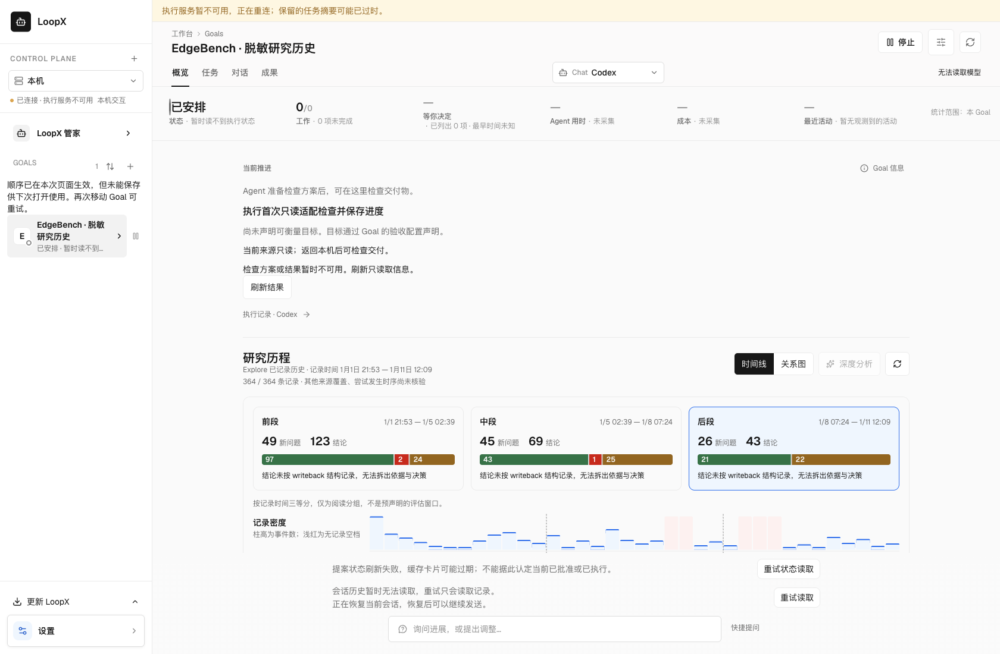
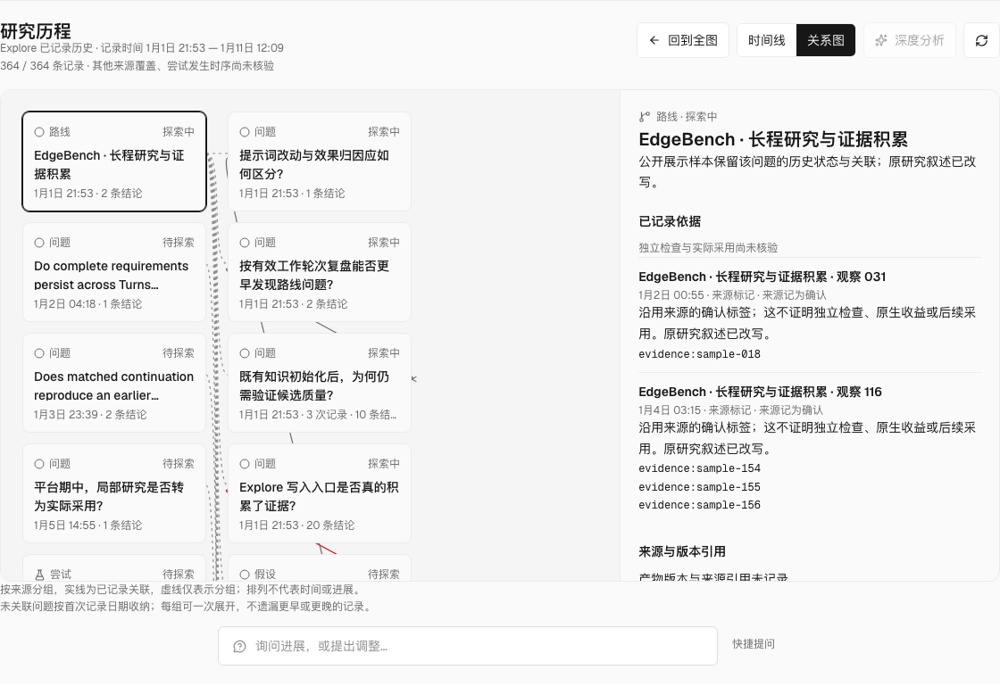

# Research-history display capture

The [fixture](../../apps/presentation/dashboard/src/data/fixtures/edgebench-research-history.json)
preserves the structure of a real EdgeBench **operator research Goal** exported
on 2026-10-16. It is not a solver trajectory, an experimental result release,
or a scientific assessment. Question and finding prose is rewritten; identities,
run labels and evidence references are opaque sample handles. Raw observations,
native scores, paths, transcripts and execution state are excluded.

The frozen source digest is recorded in the fixture. All 364 event positions,
126 node updates over 120 nodes, 235 finding records, three explicit typed edges,
14 parent updates over 12 nodes, state labels and reference equality are retained.
Labels such as “confirmed” remain source labels, not independent verification.
Parent links express grouping; neither parentage nor time proximity proves
causality or adoption. The latest exported solver snapshot had no explicit edges;
it must not be relabeled as this operator graph.

## Time and coverage

Recorded dates are shifted by whole UTC days to begin on 2030-01-01. Time of
day, UTC-day grouping, intervals and append order are preserved, including the original
828,959-second span (9 days, 14 hours, 15 minutes, 59 seconds). The illustrative
dates are not the real research dates. They measure **recording**, not attempt
age, active work, model cost or result quality. An inherited or backfilled
record does not become new research because a new session reads it.
An interval with no recorded event is a recording gap, not proof that research
stopped during that interval. Missing attempt times remain unknown.

This is a complete capture of one Explore log, not complete coverage of every
research source. Relationships are shown only where recorded. Time context
should expose range, update density and gaps alongside those relationships;
node position must not silently acquire the meaning of attempt time or progress.
Keep all history visible by default and make temporal inspection optional.
See the [two-layer workspace contract](../../docs/architecture/rfcs/goal-workspace-surface-v0.md#511-research-goals-whole-history-explore-and-on-demand-analysis).

The default time lens displays the covered record interval, recording density,
reading thirds, recorded relationship groups and unlinked questions. Dense
unlinked questions open by UTC day in one optional interaction. The relationship
view remains available without starting analysis. Phase selection retains every
recorded decision for the same question, sorts delayed backfills by record time,
and preserves the source's wait/stop/no-change outcome instead of calling it
continue. Missing times remain unplaced, not assigned to the first time bin.
These are reading choices, not a new evaluator or evidence of scientific benefit.
Record counts, density and source labels describe this capture, not outcome
improvement. Automatic native-metric comparison is not implemented here: it
requires the research producer's permitted, versioned measurements, scope and
comparison basis. The reader does not extract scores from finding prose or
compute a competing benchmark score.

## Visual reading evidence

Before this reader, the Overview offered the current folded findings without a
whole recorded-history composition. The proposed ordinary journey opens the Goal
to its full record-time lens; one optional selection opens grouped questions or
inline evidence, and the relationship view remains optional. No additional owner
statement, configuration, model call or execution approval is required to read.





These are packaged UI captures over the rewritten history fixture. Execution and
session warnings in the standalone preview describe its deliberate read-only
boundary. They are not an installed App or an operational benchmark claim. The
whole viewport keeps history and evidence together, compresses unlinked questions
by UTC date, and leaves unrelated runtime diagnostics outside the history reader.

## Reproduce

Build and verify the packaged Chat from the worktree root, then run:

```sh
uv run --extra test python scripts/chat_bundle.py build --install
uv run --extra test python scripts/chat_bundle.py verify --source
LOOPX_PERSONAL_WORKSPACE_PACKAGED=1 LOOPX_PERSONAL_WORKSPACE_SCENARIO=research-history node examples/personal-workspace-browser-smoke.mjs
```

The scenario uses a disposable registry/runtime and the production history
HTTP owner. It reads every page into the packaged UI, distinguishes explicit
edges from parent grouping, preserves selection across reload, tests narrow
layout and a failed-refresh recovery, and verifies unchanged source bytes,
zero mutation attempts against that history owner and no Agent starts. Its surrounding workspace is a test
scaffold. It does not validate the installed desktop App, native result curves,
Agent analysis or scientific conclusions. The backend can be started separately
for read-only inspection; its execution services are deliberately unavailable:

```sh
uv run --extra test python examples/personal-workspace-browser/research-history-backend.py
```

The backend freezes the fixture bytes and digest at startup. Restart it after
editing the capture; a later file read must not retag an already served snapshot.
Standalone inspection rejects all writes, including presentation preferences;
execution/session warnings describe this fixture boundary, not a live benchmark.

中文：这是保留真实结构与相对时间的脱敏研究工作图，不是 solver 轨迹或原生成绩。
所有正文均已改写，引用只保留相等关系；完整源材料留在私有边界内。以记录时间呈现
研究跨度与间隔，以显式边呈现关联，不能从日期、会话轮次、节点位置推断研究收益。
