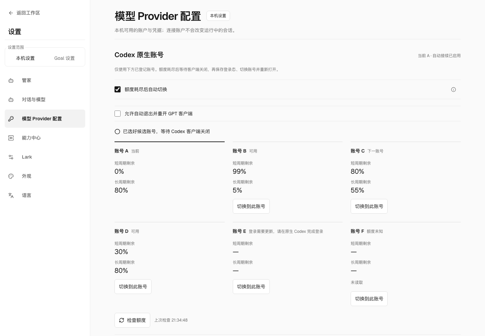
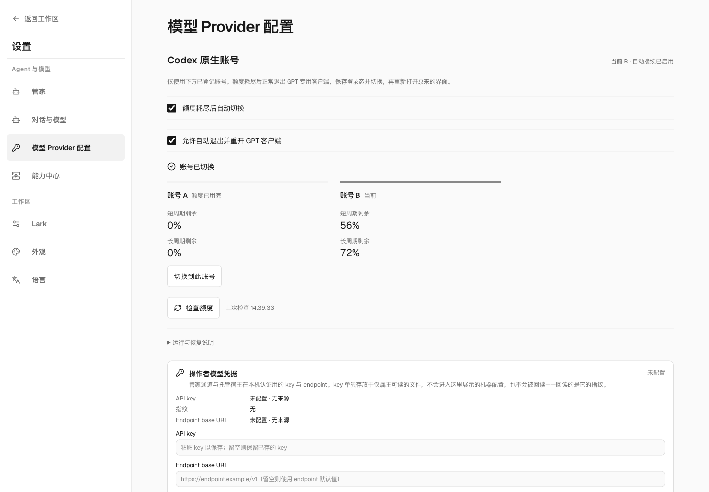
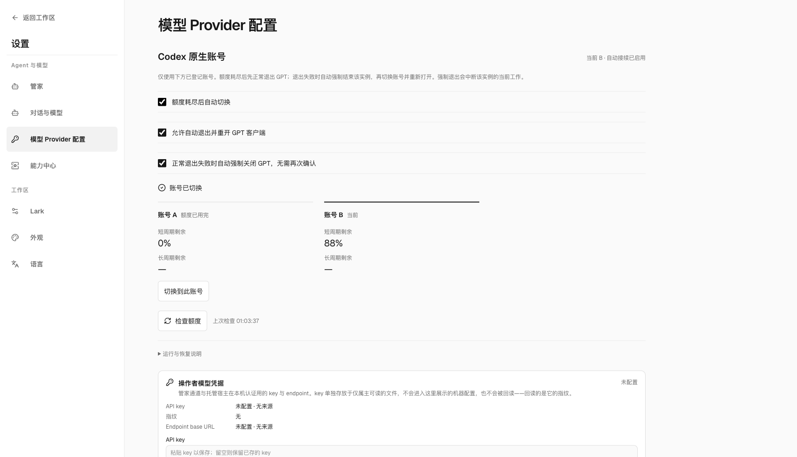
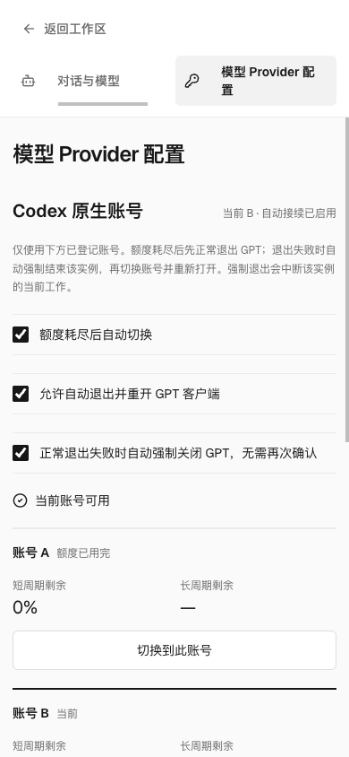

# Native Codex accounts

The optional `loopx-codex-provider-routing` provider replaces the recommended CPA
path with native slots. It has no new Core capability id. Credentials and lifecycle
stay in this package; Core composes the App transport. Python adapts existing
private file/process owners; `native_policy.ts` owns availability and selection.

## The user task

Previously an exhausted account required finding another account, closing clients,
selecting it by hand and reopening the GPT interface. In
**Settings → Model provider → Native Codex accounts**, LoopX checks allowance and
selects/reopens when the native owner admits it. Enable automatic handoff and
**Allow automatic GPT client quit and restart** for the complete automatic path.
The page reads back accounts,
windows, waiting cause and recovery. Tokens and identity claims stay private.

**An open native Codex client is an occupied owner, even between turns.** With
restart permission, the provider requests a normal AppKit quit of only the
inspected GPT instance, waits for exit and native idle, saves/switches the login,
then reopens that same route. It never addresses a shared bundle id or quits a
different route. With the separate force permission below, a refused or timed-out
normal quit can escalate against that same inspected instance. Otherwise those
failures, or remaining CLI/file owners, leave credentials unchanged and pause
automatic shutdowns until a check. Changed process ownership leaves credentials
unchanged and consumes the bounded retry budget.
Without this additional permission it continues to wait for closed clients.
It does not implement hot login replacement, job replay or
resumption of an interrupted turn. If every
account is unavailable, it waits for the observed reset and checks again.

## Prerequisites and activation

Install in the same Python environment as LoopX, then restart its App/Chat service:

```sh
python -m pip install ./packages/loopx-codex-provider-routing
loopx-codex-accounts status
```

The native adapter requires POSIX, the installed **Personal Apps** GPT slot owner
(`personal-apps` with adjacent `personal_apps.py` and `personal_accounts.py`), its
registered native GPT route, and the official `codex` CLI. Switching is macOS-only
in that owner. This package adapts that installation; it ships no second account
vault or launcher. Other hosts show unavailable. Node 22.18+ or 24+ runs the
TypeScript selector. Enrol accounts through the native owner's official login.

Click **Switch automatically when quota runs out** to authorize the listed slots
as destinations. Installation alone grants no account effect. The App observer
runs with its serving LoopX process and rehydrates the saved opt-in on restart.
Client restart is a separate permission, off by default and absent from older
policies. Enabling it also permits a subsequent explicit manual switch to quit
and reopen the GPT instance. Neither permission is enabled by installation.
**Force quit GPT if normal quit fails** is a further, default-off permission.
When enabled, normal refusal or timeout automatically force-quits only the
observed GPT launch, then continues switching and reopening without another
confirmation. The PID, executable, launch date, selection and quota freshness
must still match. The launch probe must explicitly contain `launch_time`: a
positive finite timestamp retains the launch-date fence; explicit `null` from
Launch Services uses the inspected PID and executable instead. Missing fields,
invalid types and non-finite timestamps cannot authorize force quit. A successful
normal quit never escalates. Other CLI/file owners remain holds. Force quit can interrupt
work in that instance; it does not authorize replay of submitted jobs.
An operator-owned service independent of the App can run the same observer:

```sh
loopx-codex-accounts watch
```

Do not run a busy shell loop. A private lock serializes hosts; observations carry
next-due times. This provider is independent of Goal compute quota, heartbeat
settlement and the model data plane. CLI mutations take JSON on stdin with
revisions from `status`:

```sh
loopx-codex-accounts configure <<'JSON'
{"expected_revision":0,"enabled":true,"restart_clients":true,"force_quit_clients":true,"slots":["a","b"]}
JSON
loopx-codex-accounts refresh
```

Explicit `switch` accepts `manual_slot`, `expected_selection` and a unique
`operation_id`; retrying it does not repeat selection. `recover` and `rollback`
require `expected_revision` and `expected_selection`. App buttons use the same
fences. `--runtime-root` selects a custom private runtime; browser requests
cannot supply paths, executables or source files.
`reopen` accepts `expected_selection` and retries only opening a committed
selection. It never repeats the credential switch.
Explicit checking or selection can connect the registered slots with automatic
effects still off. A manual choice may select an exhausted/expired account for
native sign-in or inspection; this never qualifies it for automatic selection.

## Availability and continuation

Usage checks use verified HTTPS without model calls, bound response size and
refuse redirects. Schema drift/network failure means unknown, never exhausted.
If the HTTP transport fails and the host already configures a SOCKS route,
the provider can use its installed curl transport for the same fixed HTTPS
quota endpoint. Proxy and authorization headers travel on stdin, never argv or
logs. It does not change proxy settings or retry HTTP authentication denials.
The active native client owns its login refresh. A distinct inactive account
can refresh through an isolated official App Server; rotated bytes are saved
only to that slot under native locks after identity and selection checks. No
active-home copy is refreshed.

A rejected inactive refresh is cached against that private login-cache revision;
background checks do not repeatedly retry the same rejected credential. A new
native login or an explicit check permits one new attempt. This refusal stays
visible as a sign-in requirement, rather than aging into usable allowance.

The selector prefers App Server `rateLimitsByLimitId.codex` over the legacy
bucket. Review/other product buckets cannot establish Codex availability.
Missing/invalid/future-dated or older-than-two-minute samples stay unknown. A
past reset invalidates an old exhausted sample; it does not grant new allowance.
100% subscription use with positive credits stays available; absent credit facts
remain unknown. Login errors, generic 429, query failure and measured exhaustion
are distinct. The observer never buys credits or uses reset coupons.

Only fresh active-account exhaustion starts automatic selection. Destinations
must be allowlisted and freshly available. Automatic selection prefers the
largest remaining subscription percentage, taking the lower remaining value
across each account's reported short and long windows. For example, 99% short
and 5% long ranks below 80% short and 55% long. Equal values keep the configured
ring order after the active account; a single reported window uses that window.
These observations do not establish absolute remaining tokens or equal plan
capacities. Positive credits retain their existing availability semantics but
do not count as additional subscription percentage. An available current account
is never preempted. Switching retains the five-minute cooldown.
An external native/manual choice wins and
starts a cooldown. Busy clients defer; refused/timed-out clients and remaining
file owners pause further shutdowns. Changed clients and other repeated failures
stop after three attempts until an explicit check/reconnect. Successful quota
reads do not reset that budget, which survives observer restart. A completed
switch, explicit check/reconfiguration or later native choice can reset it.
Quota resets require new observations.
A paused observer still reads native selection metadata: a later native/manual
choice invalidates the old account observations and failure pause, then starts
the usual cooldown without another shutdown attempt.
All-unavailable accounts are checked again at the next reset or within five
minutes; unknown observations retry within one minute. These are bounded usage
reads, not model probes. The managed extension's enable/disable controls its
permissionless qualification protocol; the native host has this separate
explicit opt-in and stop lifecycle.

Version 0.12.3 changes candidate ordering for an already enabled observer; it
does not enable handoff, client restart or force quit. The settings help explains
the percentage comparison on hover, keyboard focus or tap. The six-account
packaged views below use the production HTTP service, private state store and
TypeScript policy with synthetic quota and a simulated busy native transport.
They qualify presentation and selection readback, not a real credential swap:
B has 99% short-window but 5% long-window allowance; C has 80% and 55%, so C is
selected while A stays current until the existing owner admits switching.



[Narrow account settings](docs/assets/native-accounts-quota-narrow.png) ·
[Selection help on demand](docs/assets/native-accounts-quota-help.png)

An intent is durable before the effect. A restart-authorized switch runs in a
separate POSIX session and writes a private completion receipt, so quitting the
calling Codex App does not kill the switch/restart or its result channel. A
restarted observer waits for that receipt instead of dispatching another switch.
An interrupted worker remains visible and recoverable; an unresolved live
worker cannot be overwritten by reconfiguration or recovery. If shutdown succeeds
but switching fails, the unchanged source App is reopened when native preflight
allows it. An incomplete native journal stays closed for recovery.

The native owner checks idle and the
selection revision under its own locks and immediately before writes, saves
outgoing token rotations, commits and reads back. A lost reply reconciles
selection without replaying a switch. Interrupted native journals require
existing recovery, which refuses to overwrite later edits. Model settings and
history stay outside the transaction. Reopening failure is reported after
committed selection, without switching again.
The same checks reject expired automatic quota evidence before shutting down or
writing credentials. A manual/native choice during exit or launch wins.

Private Bot requests that failed with `usageLimitExceeded` can continue through
their original delivery worker after fresh usable allowance is independently
observed. Admission requires the exact original user-only native inventory,
unchanged source and grant, idle canonical queue, bounded backoff and a durable
per-request attempt identity. A tool, answer, correction, unknown inventory or
unavailable allowance prevents continuation. The old failure remains immutable;
the new Turn resumes the same Session, and its idle model client reloads the
current login. This path requires the optional provider's availability policy
in the Bot's Python environment; it never replays the failed Turn or delegates
business work from a repair Agent.

## Disable, upgrade and rollback

Turn the switch off to stop automatic effects. CLI `configure` with
`enabled:false` also works offline. Stop a separate `watch` process through its
service manager. Stop/restart the serving process before uninstalling loaded
code. Uninstall leaves Core and native slots intact.
An already dispatched credential transaction finishes and reopens safely even
when the observer is stopped; disabling never discards that pending intent.

Activation pins the two installed native source files. Updates produce
`adapter_changed`; **Reconnect** reads and pins the installation again. An old
observer never silently adopts new source. Private state contains paths, pins,
policy, content-free observations and an intent, never tokens.

From CPA, first stop its separately owned service and restore a backed-up native
configuration using its existing operator workflow. Keep the selected model;
review removal of active custom provider/catalog/profile overrides. The native
adapter refuses a non-native default and never edits an App bundle or rewrites
a running home for migration. The [native template](templates/codex-app-config.toml)
illustrates the new route; the [legacy template](templates/legacy-cpa-config.toml)
and explicit CPA operator remain for deliberate rollback. No credential or
history conversion occurs.

## Qualification boundary

Tests challenge exhausted/unknown/credit-funded facts, allowlists, manual fences,
duplicates, concurrency, busy deferral, lost replies, stop-before-effect and
recovery with synthetic credentials. Browser evidence must use the packaged
page with the owning backend and a recovery case. Installed native file/process
qualification uses a disposable home and a signed disposable Cocoa App: actual
AppKit normal quit, refusal, native idle/save/switch, source reopen on failure,
restart failure recovery and a detached worker surviving its owned caller exit.
Quota and authentication transport remain synthetic. Read-only live status certifies neither
an actual account swap nor installed adoption or uninterrupted hot switching.

## Packaged example

The packaged settings page below uses synthetic account aliases and allowance,
with the actual native file/transaction owner and a disposable Cocoa App.
Usage/OAuth responses are simulated; a real-account cutover is not qualified by
these images. Desktop and narrow views keep the selected account
visible even when the account list continues below the viewport.



[Narrow account settings](docs/assets/native-accounts-phone.png)

### Force-quit settings / 自动强关设置

The packaged settings page persists the optional permission and describes the
interruption effect before selection. These screenshots use synthetic A/B
accounts through the shipped HTTP service, native policy and private state
owner; they do not show a live credential transaction. Unknown quota was also
exercised, followed by a fresh successful check without changing the account.

设置页保存可选强关授权，并在选择前说明中断效果。下图通过实际打包网页、HTTP
服务、原生策略和私有状态 owner 验收，账号 A/B 为合成数据，不代表真实凭据切换。
另已验收额度未知及重新检查恢复；未知期间没有换号。




