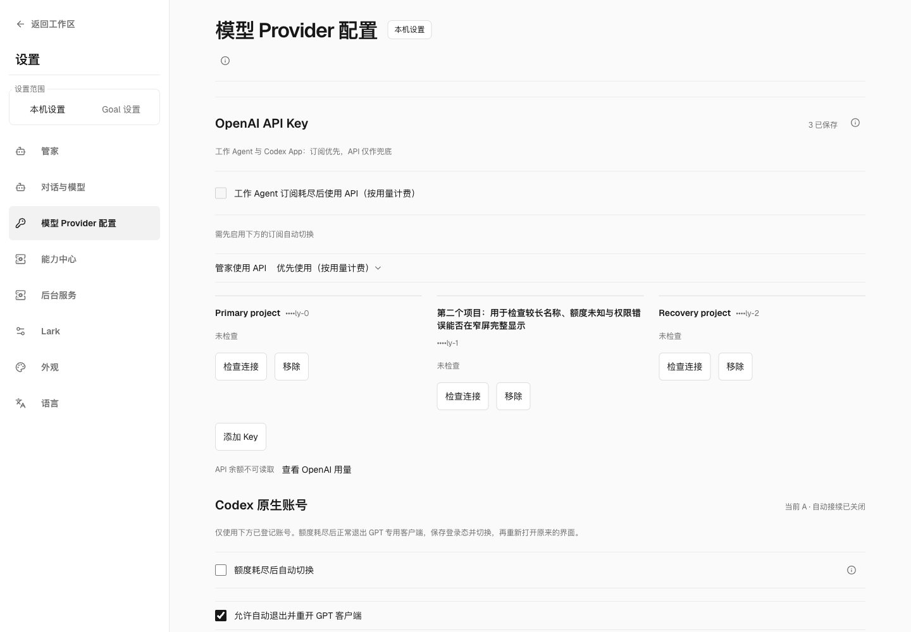
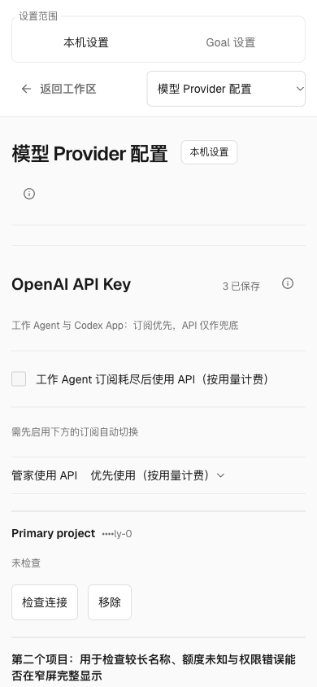
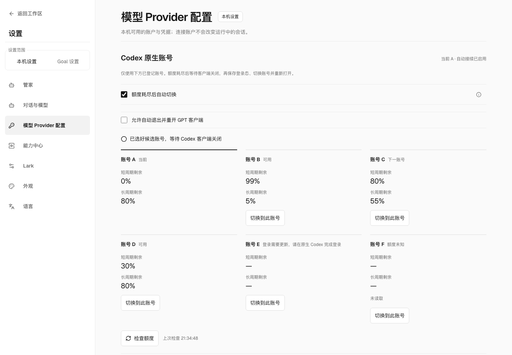
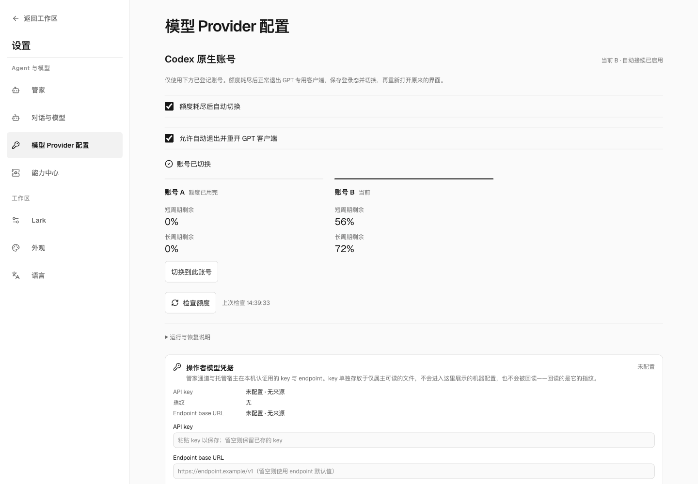
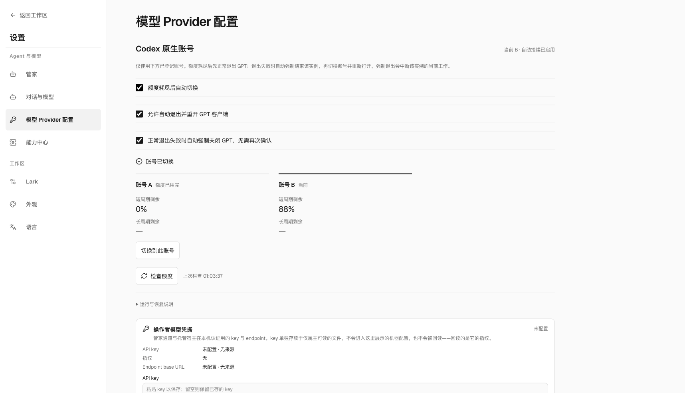
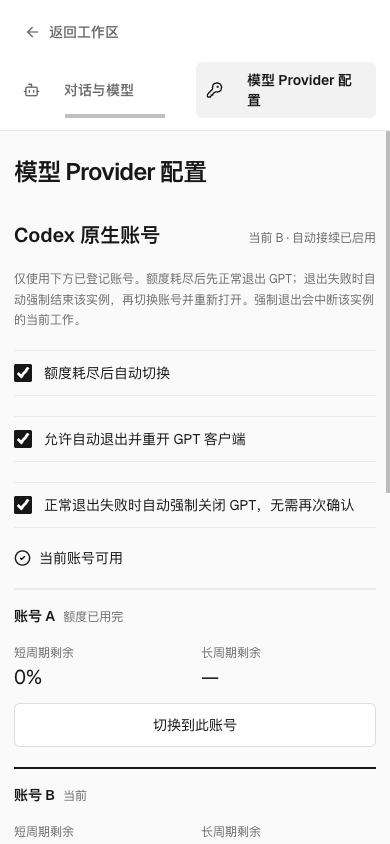
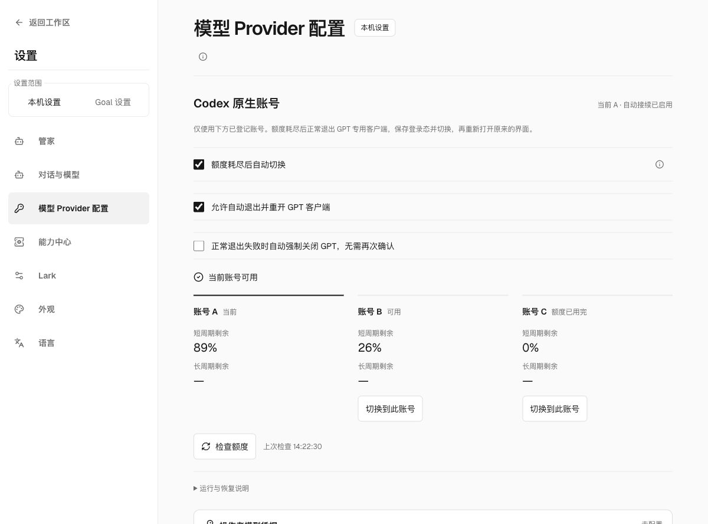
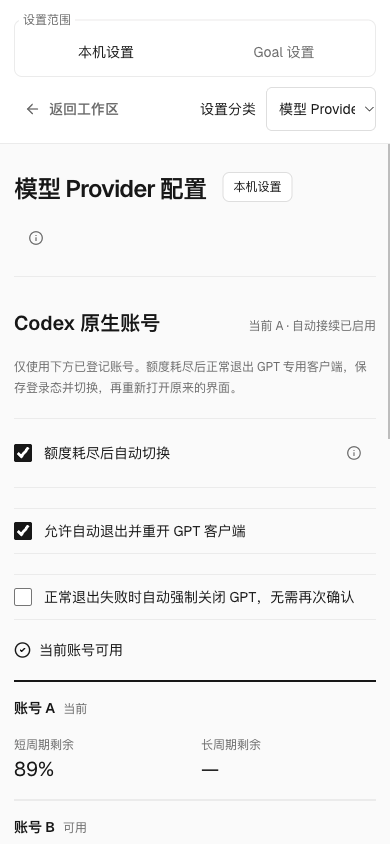
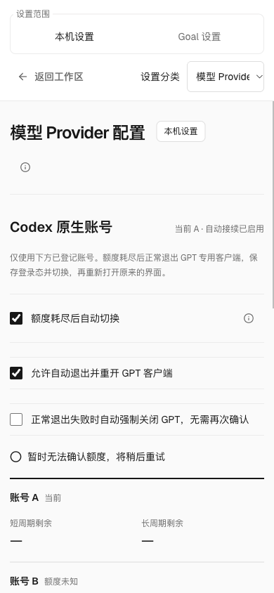

# Native Codex accounts

The optional `loopx-codex-provider-routing` provider replaces the recommended CPA
path with native slots. It has no new Core capability id. Credentials and lifecycle
stay in this package; Core composes the App transport. Its packaged Python owner
handles credential/file/process IO; `native_policy.ts` owns availability and
selection. No dotfiles checkout, Personal Apps command or external Python module
is required.

## Installed provider and transport lifecycle

Version 0.15.1 ships a native provider entrypoint and a packaged
`native-extension.toml`. Register **loopx-native-account-provider** through the
existing extension lifecycle. The older permissionless qualification extension
remains separate: its successful doctor does not certify native accounts or a
running model transport. Neither registration enables paid API use, selects an
account, creates another Chat worker, nor authorizes replaying business messages.
Core's existing optional native account imports and original Lark extension stay
the execution path; the provider owns only accounts and model transport.

Install a reviewed wheel into an immutable virtual environment outside any
checkout/worktree. Supply Python 3.11+ and Node with TypeScript stripping support;
the native doctor actually executes the packaged TS bridge. Use the same
environment for the existing Core/Chat host and provider entrypoints. Example
operator sequence (paths and wheel are operator-supplied):

```sh
python3 -m venv --system-site-packages "$PROVIDER_ENV"
"$PROVIDER_ENV/bin/python" -m pip install "$REVIEWED_PROVIDER_WHEEL"
export PATH="$PROVIDER_ENV/bin:$PATH"
PROVIDER_MANIFEST="$("$PROVIDER_ENV/bin/python" -c 'from importlib.resources import files; print(files("loopx_codex_provider_routing").joinpath("native-extension.toml"))')"
loopx-native-account-provider --doctor
loopx extension install --manifest "$PROVIDER_MANIFEST" --execute
loopx extension doctor loopx-native-account-provider --execute
```

Keep the existing runtime root, private native-account state, key store and relay
credentials outside this installation. Preserve original session storage, source
bindings, grants, limits and LaunchAgent identity. Use Core's normal host installer
to point that same host at the qualified interpreter, and its normal idle/restart
boundary to adopt it. Do not retain custom launch scripts or editable imports in a
temporary worktree. A missing optional channel or its credentials remains an
explicit unavailable channel; never reconstruct credentials from chat history.

When an existing macOS `com.loopx.codex-native-accounts` LaunchAgent watches
the same account root as managed Chat, adopt the qualified Core and its pinned
provider environment together. Run the installed target's
`update activate --service all --runtime-executable <target-loopx>`.
The supported direct `watch` job participates in the same handoff as Chat and
Status. The handoff waits for accepted Chat and account work, starts the
observer first, and verifies its lock and both loaded builds from the 0.15.5
observer heartbeat before committing.
It restores the previous job routes on failure. Once the watcher has been
adopted, a Core update without a pinned provider defers before replacing any
service. Core-only updates still leave unbound standalone watchers in place.
Run the provider's separate relay reconciliation after the managed processes
have adopted the same build.

`loopx-native-account-provider` reads this JSON protocol on stdin:

```json
{"schema_version":"loopx_native_account_provider_v1","operation":"status"}
```

It returns content-free loaded-build, instance, PID, admission state and active
request count. `--runtime-root` selects an existing owner; default is `~/.loopx`.
The doctor distinguishes installation readiness from message delivery, and never
uses a model or checks an API key against an upstream service. An unstarted relay
is a valid installation state; a healthy legacy or mismatched running daemon is
not a qualified installation. Since 0.15.4, `consumer_readiness` reports worker
and steward independently. An unconfigured steward route does not block the
worker. If a configured route is unavailable, or the two health responses
identify different relay instances, installation verification fails and each
route keeps its own status. The legacy `relay` field still reports the worker.

Version 0.15.8 reports `adapter_readiness` alongside relay readiness. With an
enabled account policy and a saved adapter, the local probe verifies the same
owner-file pins and native route as Chat model preparation. A stale pin reports
`adapter_changed` and fails installation readiness even when both relays answer.
A malformed saved policy reports `state_untrusted` and retains the two relay
observations.
After adoption of the reviewed package, use the existing **Reconnect** action
with the current policy and check the live status again. For package-only
verification before adoption, pass a disposable `--runtime-root` to `--doctor`.

Keep original-message acceptance as a separate end-to-end check.

For upgrades, install the reviewed target into a new immutable environment and
invoke its provider with `operation: "reconcile", execute: true`. This checks the
configured steward route as well as the worker, without creating credentials.
The model transport's ordinary `ensure` also performs reconciliation for its
own route. An authenticated
new-protocol daemon with a different loaded build stops new admissions, drains
already admitted model requests, and releases its existing owner lock before one
new daemon starts. It closes connections still sending headers or request bodies.
The model, route credentials, key policy and message queue stay
with their existing owners. A bounded timeout returns `api_relay_drain_pending`;
read status later instead of forcing exit or replaying a Turn. Old `/health`
response bytes remain compatible, but do not qualify version adoption.

A pre-0.15.1 daemon has no drain protocol. The explicit reconcile request may
include `legacy_pid`, requiring same-UID kernel executable/birth identity, exact
module and runtime arguments, the relay lock and listening-port ownership,
rechecked before normal SIGINT. Unknown ownership, PID changes and busy draining
remain held. There is no forced kill. This migration cannot be requested with a
model transport token; its separate control credential stays in mode-0600 runtime
state and never enters model transport results.

After successful live reconciliation, use `loopx extension upgrade --manifest
"$PROVIDER_MANIFEST" --execute`, run the doctor and independently verify the
original Core service and message returns. Rollback uses the previous immutable
environment and its normal extension/host rollback paths with the same drain
boundary. A successful pip install, plugin registration or relay health response
alone never means pending user questions were answered.

## The user task

Previously an exhausted account required finding another account, closing clients,
selecting it by hand and reopening the GPT interface. In
**Settings → Model provider → Native Codex accounts**, LoopX checks allowance and
selects/reopens when the native owner admits it. Enable automatic handoff and
**Allow automatic GPT client quit and restart** for the complete automatic path.
The page reads back accounts,
windows, waiting cause and recovery. Tokens and identity claims stay private.

### OpenAI API fallback

Version 0.13.0 adds **OpenAI API keys** on the same Model provider page. Add a
named project key, read its masked suffix, explicitly check connection, or remove
it. Keys remain in a separate private mode-0600 file under the same runtime owner;
browser/CLI responses never return their complete values. Adding a key alone does
not enable an observer, change the native login or authorize paid model calls.

Enable subscription automatic handoff, then **Use API after subscription exhaustion
(usage based billing)**. API fallback is a separate, default-off permission.
Every authorized subscription must have fresh measured exhaustion before the
native policy selects API. A healthy subscription always ranks first; an unknown
or failed subscription check cannot opt a request into paid use. While API is
active, a recovered subscription wins at the existing idle/restart boundary and
switch cooldown. Model settings and history stay with the same GPT route.
API and client-restart permission edits retain the existing subscription
allowlist. API permission can be revoked while automatic routing is off or the
last key has been removed; enable prerequisites do not prevent revocation.

The packaged native account owner supports `API_KEY_SLOTS_VERSION = 1`. It enrolls
one loopback relay credential and uses the same launch/account locks, idle checks,
credential/config transaction, readback and rollback as subscription switching.
Real OpenAI keys stay in this extension, outside the native account vault. The
dotfiles adapter imports this owner; it contains no second credential writer.
The native owner uses the official `openai_base_url` override on the built-in
`openai` provider and removes that override on subscription return. The provider
identity stays stable for existing conversations; other custom providers remain
launchable when they define a top-level Responses API gateway. An API account
slot records its selected gateway provider; selection restores that provider and
its model catalog, while a subscription slot selects the built-in `openai`
provider and removes the managed API endpoint. API and subscription logins are
therefore never sent to the other route. A custom provider must not shadow the
built-in `openai` provider, and profile overrides remain ineligible because their
effective provider cannot be bound safely to the transaction.

Every custom provider that can carry the loopback relay credential must declare
its `base_url` (for example `http://127.0.0.1:57500/v1`). A definition without
`base_url` resolves to `api.openai.com`; Codex context compaction can use that
default even while another provider is selected, so the relay-scoped credential
is presented to OpenAI and rejected with `401 invalid_api_key`. Installers that
add chat transports should write the relay endpoint into each provider
definition and verify it on readback.

A local authenticated transport sends the original selected model and complete
Responses body to OpenAI. Model requests require one valid Content-Length and
are eligible for dispatch after every declared byte has arrived. A connection
that stalls while sending the request closes after ten seconds of inactivity.
An explicit upstream quota rejection, 401, 403 or temporary 429 can
try the next configured key before output. Each key is attempted at most once per
request, with typed cooldowns; model permission failures are scoped to that model.
Unknown network effects, ordinary request/server failures and any started stream
are not retried on another key. No job replay, model substitution or synthetic
completion is added. For HTTP/1.1 clients, the relay streams bytes as they arrive
and leaves the response incomplete when an upstream transfer is truncated. A
complete HTTP transfer alone does not prove a completed model response. A
truncated rejection body or one larger than the 64 KiB inspection limit cannot
trigger another key. There are no background paid probes. The transport survives
the Chat/App restart used for native handoff. Disabling stops new admissions and
drains admitted model requests before its process exits. With the policy off,
an existing subscription is never routed through this transport.

Version 0.15.2 recognizes the official `credit_balance_exhausted` error in both
HTTP rejections and typed streaming failures. A streamed rejection cools that
key for later independently admitted requests; its current stream remains
unchanged and is never replayed. This is an error observation, not a billing
balance query or permission to add credits. See the official
[API error codes](https://developers.openai.com/api/docs/guides/error-codes).
For an HTTP 429 with this code, the existing quota cooldown (300 seconds when
no `Retry-After` is supplied) replaces the generic rate-limit cooldown.

Version 0.15.3 tries eligible alternatives before a previously rejected key,
including when the next independently admitted request arrives after its
cooldown. Among rejected keys, the oldest observation is tried first; ties and
keys without a known rejection retain configured order. Model-specific
permission failures affect only that model. An expired rejection remains
eligible and a subsequent accepted request clears its preference penalty.
Selection reuses the existing private runtime observations, adds no probes,
and never retries an admitted stream or overrides the subscription/API role.

Version 0.15.6 treats an API route as ready only while at least one configured
key is currently eligible after authentication, rate-limit and billing
observations. If the active API pool becomes unavailable, an available
subscription is selected again; when none is available, status reports
`all_unavailable` instead of claiming `api_active`. `api_fallback` stays enabled
through this transition.

Version 0.15.7 keeps subscription and managed API-fallback routes on Codex's
built-in `openai` provider identity. Managed API fallback changes only
`openai_base_url` to the loopback relay, migrating legacy relay provider IDs
(such as `openai_retry20`) when selected so built-in sessions retain the same
provider binding across fallback transitions. API slots bound to an explicit
custom Responses gateway preserve and restore their selected gateway provider
and model catalog across account switching, including gateways that share the
loopback relay endpoint.

**Check connection** only requests the official
[`GET /v1/models`](https://developers.openai.com/api/reference/resources/models/methods/list).
It makes no inference call and does not establish spendable quota. Its 401, 403,
429 and network states remain distinct. A models permission denial does not prove
inference is unavailable. The App shows per-key actual request outcomes, model,
last observation time and the last reported rate-window requests/tokens left when
OpenAI supplies those headers. These are observations of a rate window, not a
monthly allowance or account balance. OpenAI's
[`Costs` endpoint](https://developers.openai.com/api/reference/resources/admin/subresources/organization/subresources/usage/methods/costs)
requires an Admin API key; project keys do not expose an authoritative billing
balance. The page retains **API balance unavailable** and links to OpenAI usage.

The same private store is available through `loopx-codex-accounts keys-status`,
`keys-add`, `keys-remove` and `keys-check`. Mutations accept JSON on stdin with
`expected_revision` from `keys-status`. `keys-add` takes `label` and `api_key`;
`keys-remove` and `keys-check` take the returned `key_id`. Never pass a key as a
command-line argument. Native `configure` accepts `api_fallback: true` alongside
its existing policy fields. A stale revision refuses a mutation; re-read before
retrying. Removing a saved key does not revoke it at OpenAI. Disable API fallback
to stop new API requests; select an available subscription through the existing
native handoff controls. The current native recovery/rollback owner retains any
incomplete credential transaction.

0.13.0 在同一设置中提供 Key 配置、脱敏回读、只读检查和默认关闭的 API 接续开关。
订阅始终优先：所有授权订阅均被新鲜观测确认为耗尽后才进入 API；订阅恢复后沿用原有
空闲、重启、冷却和恢复边界返回。扩展内置唯一原生账号 owner，dotfiles 只导入并映射
旧配置；LoopX 不依赖 dotfiles。API 上游 Key 留在扩展私有存储，原生槽位只保存本地
中转凭据，不绕过原事务或复制会话历史。
顶层 Responses API 网关可以直接启动并参与账号切换。绑定显式自定义网关的 API 槽位记录
所选网关，切走并重新选中时恢复该 provider 与模型目录，共用中转地址的网关也保留原绑定。
受管 API 接续（含 `openai_retry20` 等已知旧中转 provider 的槽位）与订阅槽位共用内置
`openai` 标识，通过 `openai_base_url` 切换本地中转，使既有会话在账号与受管 fallback
间恢复时保持同一 provider 绑定。订阅槽位使用内置 `openai` 并移除受管的 API 地址，避免
把订阅凭据发往网关。自定义 provider 不得覆盖内置 `openai`，profile 覆写仍不参与账号事务。
Key 轮换依据输出前收到的明确额度、认证、权限或限流错误，每次请求每把 Key 最多
尝试一次；网络效果不明、普通请求错误和已开始输出的流不会重放，不替换模型，也不做
后台付费探测。关闭后停止新请求并等待已接收请求结束。App 显示实际请求结果和上次
限流窗口余量；项目 Key 的账单余额保持未知，连接检查成功也不代表还有可消费额度。
API 及重启权限的编辑保留原订阅授权范围；关闭自动接续或移除最后一把 Key 后，仍可
撤销已授予的 API 权限。

**An open native Codex client is an occupied owner, even between turns.** With
restart permission, the provider requests a normal AppKit quit of only the
inspected GPT instance, waits for exit and native idle, saves/switches the login,
then reopens that same route. It never addresses a shared bundle id or quits a
different route. With the separate force permission below, a refused or timed-out
normal quit can escalate against that same inspected instance. Otherwise those
failures leave credentials unchanged and pause automatic shutdowns until a check.
Remaining CLI/file owners wait without consuming that failure budget and resume
automatically after the blocker releases. Changed process ownership leaves credentials
unchanged and consumes the bounded retry budget.
Without this additional permission it continues to wait for closed clients.
It does not implement hot login replacement, job replay or
resumption of an interrupted turn. If every
account is unavailable, it waits for the observed reset and checks again.

Version 0.14.1 reconciles selected-slot metadata when the current login uniquely
matches an existing slot and its configured provider route agrees. Status and
launch preflight use the existing account locks; a pending transaction, occupied
lock, ambiguous identity or inconsistent route retains the old selection.
An invalid or unreadable slot is not skipped to manufacture a unique match.
This reconciliation never rewrites credentials or configuration, and does not
prove that an already running client has reloaded its login.

Version 0.15.0 separates a consumer's API role from its model choice. Working
Agents and Codex App retain subscription-first ordering: `api_fallback` permits
API only after every allowed subscription has fresh measured exhaustion.
Unknown allowance never authorizes paid fallback. The account settings also
offer `steward_api_role`: `primary` prefers the existing API key pool for the
steward, `fallback` follows subscription fallback, and `disabled` excludes API
from the steward. An absent field preserves the prior fallback configuration.
Steward API primary does not require enabling subscription automation.

The steward uses a separate authenticated loopback route and a process-only
token excluded from shell tool environments. Upstream keys stay in the same private
key owner. Thread configuration selects this model transport without rewriting
the desktop login or copying credentials/history into project stores. Explicit
native provider overrides and independently authenticated project stores retain
their chosen transport. Changes apply between Turns; they authorize neither
redispatch nor replay of an interrupted request. A model-list check is not proof
of inference allowance. Known quota/authentication/permission/rate-limit
rejections may try another key before output; unknown network effects or an
already started stream never replay. API primary unavailability allows the
existing endpoint pool to consider its subscription route; it does not move a
worker to API. The API role is local vocabulary owned by this optional account
provider, not a new Core execution authority or Goal state.

In **Settings → Model Provider configuration**, keep the working-Agent checkbox
for subscription exhaustion. Use **Steward API use → Prefer API** for an
independent API primary; **Disabled** revokes it, including after the last key
is removed. The saved selector reads back the choice. These canonical guide
illustrations use synthetic accounts / 当前操作指南使用合成账号数据：





## Prerequisites and activation

Install in the same Python environment as LoopX, then restart its App/Chat service:

```sh
python -m pip install ./packages/loopx-codex-provider-routing
loopx-codex-accounts status
```

The native adapter requires POSIX and the official `codex` CLI; App switching and
controlled client restart require the macOS Codex App. Other hosts show
unavailable for those effects. Node 22.18+ or 24+ runs the TypeScript selector.
The standalone wheel includes the account vault and App IO; it does not require
LoopX Core to import or use its native CLI.

For a new installation, sign in with ChatGPT in native Codex, close clients using
that login, then choose **Register current Codex login** on the settings page.
Registration retains model settings and history and leaves automatic switching
off. The CLI equivalent is `enroll-current`, taking `expected_revision` and
`expected_selection` from `status` as JSON on stdin. The default profile reads
`CODEX_HOME` (otherwise `~/.codex`) and `CODEX_ELECTRON_USER_DATA_PATH` (otherwise
`~/.loopx/frontends/codex`); the vault lives in
`~/.loopx/codex-native-accounts/vault`.

When trusted version-1 `~/.config/personal/apps.json` GPT metadata already exists,
the package reuses that home/frontend, the existing
`~/.local/state/personal-apps/gpt-accounts` vault and its original locks in place.
It does not copy credentials or history. An upgrade changes the pinned owner, so
use **Reconnect** to inspect and accept that owner while retaining the previous
explicit policy permissions. The updated dotfiles commands import the installed
package and use those same files and locks. LoopX never imports dotfiles. The
installed-wheel regression runs without that command, repository or modules:

```sh
uv run --extra test python -m pytest tests/presentation/test_native_accounts_install.py
```

新安装无需 dotfiles：先在原生 Codex 登录，关闭使用该登录的客户端，再从设置页登记
当前登录。登记后自动切换仍关闭。已有个人配置原地复用旧 vault 和锁，不复制凭据、
SQLite 或会话；升级后通过「重新连接」接受新的扩展 owner。dotfiles 是该扩展的调用方。

Click **Switch automatically when quota runs out** to authorize the listed slots
as destinations. Installation alone grants no account effect. The App observer
runs with its serving LoopX process and rehydrates the saved opt-in on restart.
Version 0.12.8 uses the registry's declared runtime owner for this policy even when Chat
history uses a separate `--runtime-root`. The settings page and the native CLI
therefore read and update the same policy; no history or credential data is
copied. A registry without `common_runtime_root` retains the explicit Chat
runtime for its policy, so an isolated setup cannot fall back to the user's
global policy. Explicit separate registry/runtime owners remain isolated. For a CLI
watch, pass that registry owner's runtime to `--runtime-root` as usual.

An App observer and CLI `watch` sharing that policy elect one active observer
with a private process lock. Contenders perform no native account observations
or switches; they wait up to five seconds between ownership checks and can take
over when the active owner exits. Stopping a contender releases its thread
without stopping the active owner. The existing transaction lock still serializes
configuration, explicit checks and switches. Turning the policy off affects the
actual observer, while an already dispatched credential transaction retains its
normal completion/recovery contract. Upgrade and restart all existing observers
before relying on this ownership fence; an older process does not acquire it.

Client restart is a separate permission, off by default and absent from older
policies. Enabling it also permits a subsequent explicit manual switch to quit
and reopen the GPT instance. Neither permission is enabled by installation.
**Force quit GPT if normal quit fails** is a further, default-off permission.
When enabled, normal refusal or timeout automatically force-quits only the
observed GPT launch, then continues switching and reopening without another
confirmation. The PID, executable, launch date, selection and quota freshness
must still match. The launch probe must explicitly contain `launch_time`: a
positive finite timestamp retains the launch-date fence; explicit `null` from
Launch Services uses the inspected PID and executable instead. Missing fields,
invalid types and non-finite timestamps cannot authorize force quit. A successful
normal quit never escalates. Unmanaged CLI/file owners remain holds. Force quit can interrupt
work in that instance; it does not authorize replay of submitted jobs.
Version 0.12.4 also records the inspected App's descendants before quitting.
Only those helpers, with unchanged kernel executable and microsecond start
identity, can be retired after the App exits. An older orphan with no observed
parentage, a standalone CLI using the same bundled binary, or a later App launch
remains a hold. Bundle paths alone never authorize termination.
With client restart enabled, version 0.12.6 discovers all loaded current-user
LaunchAgents whose observed Codex process trees consume this home. Service names are
not an allowlist: renamed Chat services, additional providers and plists with
different filenames participate through their existing launchd manager. A
trusted plist, its loaded path, PID, executable and kernel start identity must
match. An unrelated home, ambiguous definition or unverifiable owner cannot
authorize a restart. Discovery combines open home files with the private launch
environment of Codex processes, covering warm app-servers that cached auth and
closed their files. Arguments and environment values are never projected or logged.

Version 0.12.10 retries only the read-only ownership scan, at most three times,
when a consumer starts between process enumeration and file inspection or is
independently proven to have exited during that inspection. A stable fresh
snapshot must precede the existing service restart. PID reuse, an unreadable
live process and persistent churn remain holds; no shutdown or credential
transaction is retried by this scan. A failed environment read cannot turn an
unreadable live Codex process into a proven exit.

0.12.10 对进程枚举与文件检查之间新启动、或已独立证明退出的占用，最多进行三次
只读重扫，再以稳定的新身份清单进入原受控重启流程。PID 复用、仍存活但身份不明及
持续变化继续等待；重扫不重放退出、凭据事务或业务，也不扩大 VM 的重启权限。

Version 0.12.11 checks for non-restartable holders before quitting the GPT App.
An existing `other_clients_busy` pause is rechecked automatically; an unchanged
unmanaged holder waits without repeatedly closing/reopening clients. Normal
quit refusal, unknown effects and other exhausted failure budgets keep their
existing recovery boundary. Only numeric read-only directory descriptors are
excluded from auth consumers. A read-only regular file, missing descriptor type,
directory writer or warm Codex process still blocks. The native slot owner's idle
check rechecks these read-only exceptions, followed by another typed handle scan
under its account locks. This does not restart a VM or claim to inspect a guest's
cached login; a pinned auth file remains a hold.

Before stopping a discovered Chat service, the provider uses LoopX's existing
accepted-work reader and ingress lock for its explicit runtime. Queued work,
including an orphan without an active Session pointer, completing work and
unreadable state defer the entire handoff before App quit. A new/changed service
cannot inherit the frozen restart set. The lock remains held through account
readback and restoration. A standalone observer must run in the same upgraded
LoopX environment to restart these services; missing Core support waits safely.
An already loaded archive/bootstrap Core passes its import root to the native
worker, including detached handoffs; the worker does not rely on its current
directory to rediscover that owner.
Prefer the serving App/Chat observer so normal LoopX updates also refresh it;
retire any separately installed legacy watcher through its original manager.

The enabled switch is durable intent, not a health claim. The settings page and
native status report the active observer's private, content-free heartbeat,
ownership lock and loaded provider build. A missing, overdue or older-build
heartbeat stays visible even when the last quota read succeeded. Quota readiness
and observer health are separate. Status reads never refresh their own heartbeat.
Only the lock holder writes it; another App or CLI observer remains a contender.

The existing supervised Chat service owns persistence; no second account daemon
or duplicate policy is installed. It rehydrates enabled observation on restart
and upgrade. Tick failures retry in the owner loop, dead threads can restart,
and a rejected configuration edit reconciles the observer with the persisted
policy. A stale disable cannot leave `enabled=true` with observation stopped.
Disabling and service shutdown still fence new effects; an already dispatched
transaction keeps its normal completion/recovery contract. An unresponsive
owner remains a visible hold, never permission to steal its lock or replay work.

开关表示持久授权，不等于服务健康。设置页分别展示额度状态和后台观测心跳；缺失、
过期及旧版本观测保持可见，读取状态不会给自己刷新心跳。复用既有受监督的 Chat 服务，
重启或升级后恢复已授权观测；检查失败自动重试，线程退出可恢复。配置冲突等失败不会
让「仍开启」的策略静默停掉观测。关闭或服务退出仍阻止新效果，不抢占未释放的 owner。

0.12.11 在退出 GPT App 前检查无法受控恢复的占用；原 `other_clients_busy` 暂停会
自动重新检查，阻塞解除后无需手动换号。仅有数字 FD、只读且类型明确为目录的句柄
不视为认证消费者；认证文件、写句柄、未知类型及缓存登录的 Codex 进程仍阻塞。
原账号 owner 在事务锁内复查只读例外，并再次核验句柄；不重启 VM，也不据此声称
已检查 guest 内的认证缓存。停止 Chat 前复用原在途任务读取与 ingress 锁，排队、
completing 或不可读状态均在退出 App 前等待；恢复期间保持锁与原失败/未知回执。
已加载的 archive/bootstrap Core 向原 native 子进程传递其加载路径，包含脱离父进程的
换号任务，避免依赖工作目录或误用旧安装；没有加载 Core 的独立入口仍安全等待。
观察器应随实际 LoopX 服务升级；独立旧 watcher 通过原管理器退役，避免占住唯一观察权。

Each service's restoration intent is saved privately before unloading. Version
0.12.7 waits up to five seconds for launchd to finish an acknowledged asynchronous
unload; a job that remains loaded retains its recovery intent and fails without
switching accounts. Observed
descendants are retired only while their kernel identity still matches, even if
they have since closed every auth file. The provider waits for their exit and
rechecks native idle under the existing account transaction locks. Up to three
rescans cover services that appear during shutdown. With force permission,
helpers still alive after normal termination can be killed against those same
frozen identities. No arbitrary CLI is relaunched and no submitted job is replayed.

Restoration is checked even after a partial failure. A loaded job alone is not
success: a previously running service must have a fresh live process. A failed
restore is reported as `chat_resume_failed`;
the next native request reconciles that intent without repeating the account
transaction. A changed service definition is preserved and requires local
repair rather than bootstrapping unchecked bytes. Installation does not enable
client restart or start a new Chat service.

`loopx-codex-accounts clients` performs a read-only live inventory with PIDs,
App/service/unmanaged classification and restartability. This inventory also
leaves outstanding service recovery to the existing status/switch owner. It never reads token
contents or changes selection. Unknown file owners (including filesystem/VM
services without a proven restart owner) remain visible holds; installation
does not turn them into termination targets. Discovery is best effort within
the current user's kernel visibility, not a claim to inspect auth cached inside
another user's process or a virtual machine.

Version 0.12.9 also explains unmanaged holders through Darwin's optional kernel
responsibility probe. Reparented XPC processes can retain a different manager
from the current App. A responsible PID/name is diagnostic provenance, never
App ownership or restart permission. For a verified installed Lima hostagent,
the inventory cross-checks its private pidfile and the original Lima/Colima
catalog's running instance; raw arguments, environment and catalog paths stay
private. Missing SPI/permissions, changed launch identities, ambiguous instances
or unavailable manager reads preserve an explicit hold. No guest command runs.
The existing App/LaunchAgent restart path is unchanged; externally managed
workloads require their own idle/recovery qualification. In **Settings → Model
provider → Native Codex accounts**, **Login holders** reads this same inventory.
Its collapsed summary retains held and unknown observations; expanding it shows
all observed PIDs, services and corroborated managers. **Recheck holders** only
repeats the read. It does not check quota, enable a policy, reconcile recovery,
switch accounts or end a process. The ordinary status timer does not repeat the
process scan. A failed or incomplete read clears the earlier inventory and stays
unknown, rather than reporting that no client remains. Restart eligibility is
an observation, not a guarantee or another restart permission. Actual handoff
still revalidates ownership through the original account transaction.

0.12.9 的只读占用清单会核对脱离 App 进程树的 XPC 责任进程，并对已核验的
Lima/Colima 管理器交叉读取原实例。识别到管理器不等于业务空闲或可以重启；
未知或变化的身份保留等待，不执行 guest 命令，不新增强关目标。设置页的
「登录占用」复用同一清单，可展开全部进程并只读重查；失败或部分读取显示未知。
这不改变原切换权限，VM 恢复及真实换号后的新认证采用仍需分别验收。

An operator-owned service independent of the App can run the same observer:

```sh
loopx-codex-accounts watch
```

Do not run a busy shell loop. A private lock serializes hosts; observations carry
next-due times. This provider is independent of Goal compute quota, heartbeat
settlement and the model data plane. CLI mutations take JSON on stdin with
revisions from `status`:

```sh
loopx-codex-accounts configure <<'JSON'
{"expected_revision":0,"enabled":true,"restart_clients":true,"force_quit_clients":true,"slots":["a","b"]}
JSON
loopx-codex-accounts refresh
```

Explicit `switch` accepts `manual_slot`, `expected_selection` and a unique
`operation_id`; retrying it does not repeat selection. `recover` and `rollback`
require `expected_revision` and `expected_selection`. App buttons use the same
fences. `--runtime-root` selects a custom private runtime; browser requests
cannot supply paths, executables or source files.
`reopen` accepts `expected_selection` and retries only opening a committed
selection. It never repeats the credential switch.
Explicit checking or selection can connect the registered slots with automatic
effects still off. A manual choice may select an exhausted/expired account for
native sign-in or inspection; this never qualifies it for automatic selection.

## Availability and continuation

Usage checks use verified HTTPS without model calls, bound response size and
refuse redirects. Schema drift/network failure means unknown, never exhausted.
If the HTTP transport fails and the host already configures a SOCKS route,
the provider can use its installed curl transport for the same fixed HTTPS
quota endpoint. Proxy and authorization headers travel on stdin, never argv or
logs. It does not change proxy settings or retry HTTP authentication denials.
The active native client owns its login refresh. A distinct inactive account
can refresh through an isolated official App Server; rotated bytes are saved
only to that slot under native locks after identity and selection checks. No
active-home copy is refreshed.

A rejected inactive refresh is cached against that private login-cache revision;
background checks do not repeatedly retry the same rejected credential. A new
native login or an explicit check permits one new attempt. This refusal stays
visible as a sign-in requirement, rather than aging into usable allowance.

The selector prefers App Server `rateLimitsByLimitId.codex` over the legacy
bucket. Review/other product buckets cannot establish Codex availability.
Missing/invalid/future-dated or older-than-two-minute samples stay unknown. A
past reset invalidates an old exhausted sample; it does not grant new allowance.
100% subscription use with positive credits stays available; absent credit facts
remain unknown. Login errors, generic 429, query failure and measured exhaustion
are distinct. The observer never buys credits or uses reset coupons.

Only fresh active-account exhaustion starts automatic selection. Destinations
must be allowlisted and freshly available. Automatic selection prefers the
largest remaining subscription percentage, taking the lower remaining value
across each account's reported short and long windows. For example, 99% short
and 5% long ranks below 80% short and 55% long. Equal values keep the configured
ring order after the active account; a single reported window uses that window.
These observations do not establish absolute remaining tokens or equal plan
capacities. Positive credits retain their existing availability semantics but
do not count as additional subscription percentage. An available current account
is never preempted. Switching retains the five-minute cooldown.
An external native/manual choice wins and
starts a cooldown. Busy clients defer; refused/timed-out clients and remaining
file owners pause further shutdowns. Changed clients and other repeated failures
stop after three attempts until an explicit check/reconnect. Successful quota
reads do not reset that budget, which survives observer restart. A completed
switch, explicit check/reconfiguration or later native choice can reset it.
Quota resets require new observations.
A paused observer still reads native selection metadata: a later native/manual
choice invalidates the old account observations and failure pause, then starts
the usual cooldown without another shutdown attempt.
All-unavailable accounts are checked again at the next reset or within five
minutes; unknown observations retry within one minute. These are bounded usage
reads, not model probes. The managed extension's enable/disable controls its
permissionless qualification protocol; the native host has this separate
explicit opt-in and stop lifecycle.

Version 0.12.3 changes candidate ordering for an already enabled observer; it
does not enable handoff, client restart or force quit. The settings help explains
the percentage comparison on hover, keyboard focus or tap. The six-account
packaged views below use the production HTTP service, private state store and
TypeScript policy with synthetic quota and a simulated busy native transport.
They qualify presentation and selection readback, not a real credential swap:
B has 99% short-window but 5% long-window allowance; C has 80% and 55%, so C is
selected while A stays current until the existing owner admits switching.



[Narrow account settings](docs/assets/native-accounts-quota-narrow.png) ·
[Selection help on demand](docs/assets/native-accounts-quota-help.png)

An intent is durable before the effect. A restart-authorized switch runs in a
separate POSIX session and writes a private completion receipt, so quitting the
calling Codex App does not kill the switch/restart or its result channel. A
restarted observer waits for that receipt instead of dispatching another switch.
An interrupted worker remains visible and recoverable; an unresolved live
worker cannot be overwritten by reconfiguration or recovery. If shutdown succeeds
but switching fails, the unchanged source App is reopened when native preflight
allows it. An incomplete native journal stays closed for recovery.

The native owner checks idle and the
selection revision under its own locks and immediately before writes, saves
outgoing token rotations, commits and reads back. A lost reply reconciles
selection without replaying a switch. Interrupted native journals require
existing recovery, which refuses to overwrite later edits. Model settings and
history stay outside the transaction. Reopening failure is reported after
committed selection, without switching again.
The same checks reject expired automatic quota evidence before shutting down or
writing credentials. A manual/native choice during exit or launch wins.

Private Bot requests that failed with `usageLimitExceeded` can continue through
their original delivery worker after fresh usable allowance is independently
observed. Admission requires the exact original user-only native inventory,
unchanged source and grant, idle canonical queue, bounded backoff and a durable
per-request attempt identity. A tool, answer, correction, unknown inventory or
unavailable allowance prevents continuation. The old failure remains immutable;
the new Turn resumes the same Session, and its idle model client reloads the
current login. This path requires the optional provider's availability policy
in the Bot's Python environment; it never replays the failed Turn or delegates
business work from a repair Agent.

## Disable, upgrade and rollback

Turn the switch off to stop automatic effects. CLI `configure` with
`enabled:false` also works offline. Stop a separate `watch` process through its
service manager. Stop/restart the serving process before uninstalling loaded
code. Uninstall leaves Core and native slots intact.
An already dispatched credential transaction finishes and reopens safely even
when the observer is stopped; disabling never discards that pending intent.

Activation pins the two installed native source files. Updates produce
`adapter_changed`; **Reconnect** reads and pins the installation again. An old
observer never silently adopts new source. Private state contains paths, pins,
policy, content-free observations and an intent, never tokens.

From CPA, first stop its separately owned service and restore a backed-up native
configuration using its existing operator workflow. Keep the selected model;
review removal of active custom provider/catalog/profile overrides. The native
adapter refuses a non-native default and never edits an App bundle or rewrites
a running home for migration. The [native template](templates/codex-app-config.toml)
illustrates the new route; the [legacy template](templates/legacy-cpa-config.toml)
and explicit CPA operator remain for deliberate rollback. No credential or
history conversion occurs.

## Qualification boundary

Tests challenge exhausted/unknown/credit-funded facts, allowlists, manual fences,
duplicates, concurrency, busy deferral, lost replies, stop-before-effect and
recovery with synthetic credentials. Browser evidence must use the packaged
page with the owning backend and a recovery case. Installed native file/process
qualification uses a disposable home and a signed disposable Cocoa App: actual
AppKit normal quit, refusal, native idle/save/switch, source reopen on failure,
restart failure recovery and a detached worker surviving its owned caller exit.
Quota and authentication transport remain synthetic. Read-only live status certifies neither
an actual account swap nor installed adoption or uninterrupted hot switching.

## Packaged example

The packaged settings page below uses synthetic account aliases and allowance,
with the actual native file/transaction owner and a disposable Cocoa App.
Usage/OAuth responses are simulated; a real-account cutover is not qualified by
these images. Desktop and narrow views keep the selected account
visible even when the account list continues below the viewport.



[Narrow account settings](docs/assets/native-accounts-phone.png)

### Force-quit settings / 自动强关设置

The packaged settings page persists the optional permission and describes the
interruption effect before selection. These screenshots use synthetic A/B
accounts through the shipped HTTP service, native policy and private state
owner; they do not show a live credential transaction. Unknown quota was also
exercised, followed by a fresh successful check without changing the account.

设置页保存可选强关授权，并在选择前说明中断效果。下图通过实际打包网页、HTTP
服务、原生策略和私有状态 owner 验收，账号 A/B 为合成数据，不代表真实凭据切换。
另已验收额度未知及重新检查恢复；未知期间没有换号。





### Shared policy owner / 共用策略来源

The settings page and CLI use the registry-declared native account owner even
when Chat history has a separate runtime directory. Without a declared owner,
an explicit isolated Chat runtime remains isolated. Version 0.12.8 also holds a
process lock for the observer lifetime: another App or CLI stays passive until
the owner exits. Upgrade and restart every existing observer before relying on
this guarantee; an older observer does not participate in the new lock.

设置页与 CLI 共用 registry 声明的原生账号策略来源，会话历史仍保留在原目录。
未声明公共来源时，显式隔离的 Chat runtime 保持隔离。0.12.8 通过跨进程锁保证同一
策略来源只有一个自动观察器；原观察器退出后，等待者接管。升级时需要重启所有旧
观察器，旧版本不会自动遵守新锁。

The actual packaged page and HTTP service below use synthetic A/B/C accounts.
Turning automatic switching off and back on persisted to the shared owner and
survived reload without changing the separate conversation policy. Unknown
allowance kept account A selected; a fresh successful check recovered. These
images do not qualify a real credential switch.

以下为实际打包网页与 HTTP 服务，账号 A/B/C 为合成数据。关闭、重新开启和刷新后
均读回共用策略，会话目录中的独立旧策略未被改写。额度未知时保留 A，重新检查后
恢复；不代表已完成真实账号切换。








## Chat and steward quota routing (0.14.0)

Chat observes the same native account owner at an unstarted input boundary. When
its login selection revision changes, Chat reopens its adapter on the same native
thread and reads the effective provider. It does not select accounts, start another
watcher, replace conversation history, or retry a running/unknown-effect request.
An explicit `LOOPX_CHAT_CODEX_MODEL_PROVIDER` override still pins the transport;
remove an obsolete override from the original service configuration to follow the
native owner again.

The steward has a separate endpoint pool. In the existing **Steward executor**
machine configuration, select `flexible`, primary `antigravity`, and eligible
endpoints `[antigravity, codex]`. Argon remains preferred. Verified exhaustion can
select the Codex GPT-6.1 Sol default; subscription/API selection inside Codex stays
with the existing native account policy. This setting does not edit that policy's
account candidates or grant API spending. Explicit conversation model picks,
pinned policies, and registered native Goal execution remain outside this switch.
Unknown/stale quota does not authorize fallback. A tiny positive remainder cannot
clear a recorded hard failure in the same account/model/reset epoch.

The Core Session, source audience and queue remain unchanged across endpoint
migration; each old native binding is retained for result verification. Completed
original text with malformed delegation metadata may use one restricted GPT
format review when Core has verified the exact original result, source and grant.
That review cannot run shell tools, use MCP/apps, access the network, or change the
original recipients/context. Actual handoff and original-message reply still need
their normal receipts. Unknown-effect failures remain pending rather than being
blindly replayed.

Chat 与管家复用同一个原生额度 owner；账号/API 切换仍由原有策略执行。
管家的端点候选集独立配置为 Argon 优先、Codex GPT-6.1 Sol 备用，不修改
Codex App 的账号候选集。切换只发生在尚未执行的输入边界，原会话、来源、队列
和旧原生执行证据保留。已完成答案的格式复核使用受限上下文；未确认效果的失败
继续保留，不能把格式修正或模型的“已发送”文字当成真实交付。
