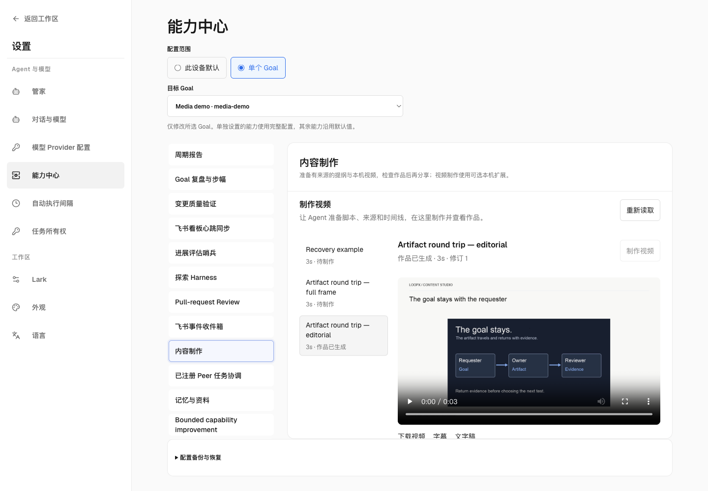
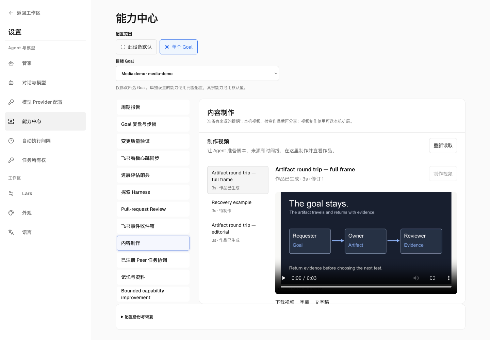

# Local video renderer

`loopx-media` is an optional distribution for the existing **content-ops**
capability. It renders an admitted composition; it does not choose sources,
run commands from a brief, use an account, call a model, or publish a movie.
Shared TypeScript admission and render transitions remain in LoopX core.
Pillow, FontTools, FFmpeg and platform speech are specialized local computation.

From a source checkout, install the executable and register its manifest:

```sh
uv tool install ./packages/loopx-media
loopx extension install --manifest packages/loopx-media/extension.toml --execute
loopx extension doctor loopx-media --execute
```

The LoopX process must have `loopx-media` on its PATH. Installation explicitly
enables the local extension. No renderer is installed, enabled or downloaded
by `content-ops media prepare`, page loading or a missing-provider read.
The manifest requests `content_media_write` for private composition output.
Use the existing extension state owner; there is no second media setting.
An isolated environment is also supported if its executable is on that PATH.

An Agent prepares the story, source SHA256s and timing through
[`content-ops media`](../../docs/reference/protocols/content-ops-media-v0.md).
In the packaged App, open **Settings → Capabilities → a Goal → Content
production**. Select the prepared composition, render, then view the video,
captions, transcript and source boundaries in the same workbench. The CLI
exposes the same operation. Rendering is local work; it grants no publication
approval. Revise the brief through the Agent rather than re-entering source
paths or protocol JSON in the browser.

Supported atoms are title scenes, measured text wrapping, animated node
diagrams, hash-bound image/video excerpts, timed captions, supplied audio,
macOS system speech, H.264/AAC encoding, a first-frame poster and full video
decode. Images retain their orientation; video excerpts retain aspect ratio.
Installed fonts must cover the visible text, with CJK line breaking supported.
RTL shaping and arbitrary font discovery are not qualified. macOS speech is
optional; other platforms require supplied audio or explicit silence.
No cloud voice, generative image/video or game engine is bundled here.

The default excerpt and Blender layouts display the title and source boundary; nonempty
`body` text is explicitly refused. Preserve a needed qualifier in those visible
fields, a separate title scene or timed captions before preparing a new revision.
The renderer also refuses a stale/direct request with unsupported body text;
it cannot return ready while silently dropping that text.

## Picture framing

For a source-led composition, an Agent can set `framing: "full_frame"` on an
image/video excerpt or Blender shot. Version 0.3.0 fits the complete picture
without cropping and keeps its source boundary in a separate strip below it.
The studio header, drawn shot title and progress bar are omitted; the title
remains in the timeline/source readback. Include needed titles in the artwork,
a title shot or timed captions. Each shot can choose independently. Omitted
framing or `"editorial"` keeps the original canonical plan and layout.

Use the explicit package upgrade/reinstall and extension upgrade/doctor route
below for an existing provider. The core refuses full-frame readiness when an
older renderer omits its framing readback. Retry the unchanged plan after the
upgrade. The workbench displays the choice and retains its existing render,
cancel, retry and verified-download journey. To roll back the composition,
prepare a new revision without framing and render it. No global setting,
source classification or publication authority changes. See the
[bilingual contract](../../docs/reference/protocols/content-ops-media-v0.md#per-shot-picture-framing).

中文：0.3.0 在原 content-ops 镜头中加入可选“大画面”构图。素材保持完整比例，
来源说明另置底栏；需要观众看到的标题由素材、标题镜头或字幕承载。Agent 准备
分镜，工作台沿原入口制作和查看。已有安装应显式升级可选包及 manifest 并运行
doctor；移除字段、保存新修订并重制即可恢复原构图。默认计划和发布边界不变。

Public synthetic packaged-workbench captures (macOS, source qualification;
not an installed-App or comprehension claim):

| Editorial | Full frame | Narrow, scrolled to movie |
| --- | --- | --- |
|  |  |  |

## Optional Blender scenes

For real 3D geometry, install the same provider with its optional Blender extra
in a Python 3.11 environment, then register and doctor the current manifest:

```sh
uv tool install --python 3.11 './packages/loopx-media[blender]'
loopx extension install --manifest packages/loopx-media/extension.toml --execute
loopx extension doctor loopx-media --execute
loopx content-ops media prepare --goal-id GOAL \
  --plan-json packages/loopx-media/examples/blender-handoff.json \
  --source-directory .
```

If this provider is already installed, use the package manager's explicit
upgrade/reinstall operation before registering the new manifest revision with
`loopx extension upgrade --manifest packages/loopx-media/extension.toml --execute`.
The registered executable and its Python environment are pinned. Install the
extra in that environment and run doctor; changing the calling process's PATH
does not replace a registered executable. Doctor checks the pinned installation,
not whether some other environment has Blender. A move to another environment
needs explicit extension registration; doctor cannot rebind an active revision.
Preparation does not install Blender. The ordinary install still supports 2D;
a missing Blender extra fails only an attempted 3D scene. Repair that local
dependency and retry the unchanged prepared composition through the same CLI
or **Content production** workbench. No second provider setting is needed.

An Agent selects a `blender` shot and supplies declarative objects, camera,
lights, materials and position keyframes. The shared TypeScript owner admits
those fields and includes them in the composition digest. The optional provider
runs actual Blender 4.5 LTS/Cycles on CPU in a separate process. Uploaded blend
files, arbitrary Python, add-ons and external asset discovery are unsupported.
Blender 5.x uses a different compositor API and is not qualified by this provider.

The workbench previews the composed movie and downloads **Blender project and
passes**. The verified ZIP retains each `scene.blend`, its input, the replay
builder, RGBA frames and a 16-bit depth pass. Depth maps Blender Z distance 0–50
to 0–65535 and clamps values beyond 50. Scene output paths are relative; opening
the blend with scripts disabled does not require embedded code. A second
process reopens each saved project and checks its geometry, keyframes, camera
and timeline before the composition can become ready. The normal renderer
then composites the RGBA frames with the selected layout and verifies the
complete encoded timeline. This does not establish the illustration's factual
truth, explanatory quality or audience understanding.

The versioned example is a five-second synthetic artifact round trip, not a
recorded Agent run or a finished creative direction. Reuse a verified result
as a digest-bound video excerpt in a larger composition instead of rerendering
unchanged 3D footage. Keep source boundaries and the editable project.
Reusing verified output preserves exact bytes. Re-rendering an editable scene
is separate: CPU rendering can vary in the last color bit between processes.

The renderer refuses a short excerpt, changed source, missing glyphs, text
overflow or speech longer than its cue. It does not fill missing footage,
silently truncate text or speed up speech to hide those failures. Prepare a
new revision for story/source/timing changes. Repair a local dependency and
run doctor again before retrying an unchanged brief. Cancellation is requested
in place and read back after the worker stops; a host interruption is recovered
by an explicit retry. An intact completed result is reused without encoding
again. Damaged result bytes cannot be downloaded as verified output.

Captions use a bounded plain-text subset. Single line breaks, ordinary
ampersands and quotes work. Internal blank lines delimit subtitle cues;
angle brackets and entity syntax are not supported by this SubRip export.
These inputs are refused before preparation and by the renderer. Use separate
timed cues for paragraphs and spell out markup or comparisons rather than
producing a subtitle file that silently loses or reinterprets accepted text.

## Bounds and review

Plans are limited to 90 seconds, 30 shots, 20 local assets and 80 ordered
caption cues, with at most 1920×1080 at 30 fps. Each source is at most 64 MiB;
all source snapshots together are at most 128 MiB. The render has a 120-second
process budget. A complex valid plan can exceed the local machine's budget;
that is a failed attempt, not a reason to mark a partial movie ready.
Each Blender scene has at most 16 box/sphere objects, 3 area lights, 24 connections
and 120 frames; a composition can include at most 3 scenes. Scene rendering,
reopening, pass checks and composition share the existing 120-second process
budget. Failed or cancelled attempts never substitute a diagram or frozen frame.

The result records exact output digests, decoded frames, render wall time,
PCM peak/clipping measurements when audio exists, and untested creative,
listening and audience-understanding judgments. These mechanical checks do
not establish narration quality, factual truth, source rights, learning gain,
virality or a better film. Review the actual result before sharing. Existing
content-item approval and delivery intent are invalidated when the plan or
rendered bytes change. The outputs remain private until separately authorized.

Disable new renders with the existing owner:

```sh
loopx extension disable loopx-media --execute
```

Existing verified results remain readable. Re-enable and run doctor after a
dependency repair. Prepared files and failed attempts remain in the registered
project's private `.local/content-media/` directory for inspection; disabling
does not delete them. There is no automatic cleanup of source evidence.

## Focused validation

Core tests do not need this distribution. For source changes, first run the
repository-invariant and lint commands used by CI:

```sh
uv run --extra test python -m pytest -q --no-cov \
  tests/test_stage2c_dependency_lock.py tests/architecture/test_top_level_module_budget.py
uv run --extra test python -m ruff check \
  tests loopx/canary loopx/control_plane loopx/domain_packs loopx/presentation
```

Then exercise the actual optional extension, encoder, source reuse, recovery
and HTTP byte serving after installing the executable in an isolated environment:

```sh
LOOPX_MEDIA_RENDERER_TEST=1 uv run --extra test --with-editable ./packages/loopx-media \
  python -m pytest -q tests/test_content_media.py
node --test tests/control_plane_ts/content_media.test.ts
```

The opt-in test uses synthetic local sources and no model or cloud service.
Its optional package dependency supplies the real FFmpeg subtitle consumer;
decoded VTT/SRT text must preserve accepted line breaks, ampersands and quotes.
The source qualification checks the editable module and executable environment
so a cached wheel cannot silently stand in for the source under review.
It is integration evidence, not a subjective or comparative creative study.

For an explicit source qualification of the optional Blender computation,
use an isolated project environment so the normal interpreter stays intact:

```sh
UV_PROJECT_ENVIRONMENT=.local/blender-test-env \
LOOPX_MEDIA_BLENDER_TEST=1 \
uv run --python 3.11 --extra test --with-editable './packages/loopx-media[blender]' \
  python -m pytest -q tests/test_content_media.py
```

The opt-in test uses the real extension and HTTP route, inspects the ZIP,
opens the blend in an independent bpy process and checks stored scene state.
It performs no cloud/model calls or public uploads. Report the actual bpy
version and platform; this command is not a claim of cross-platform delivery.
